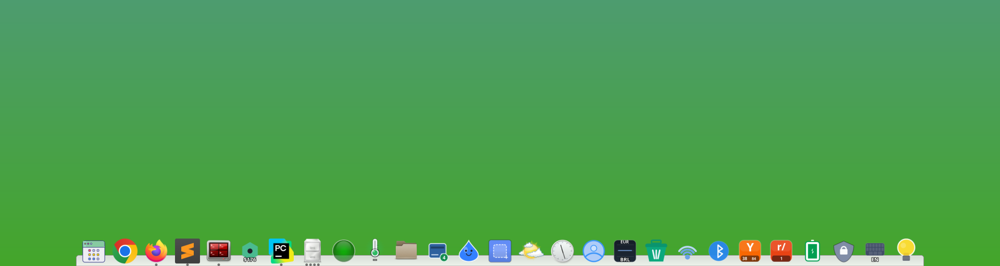
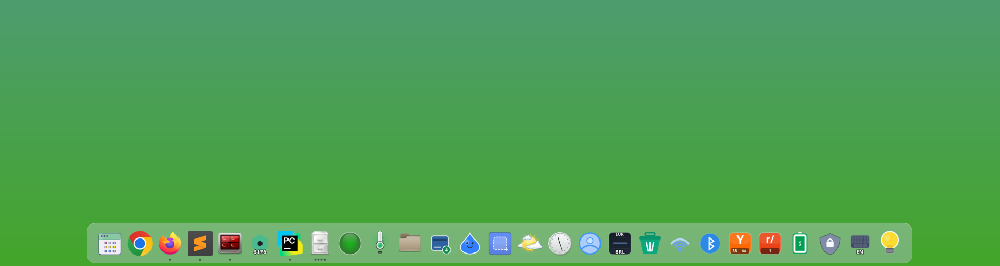
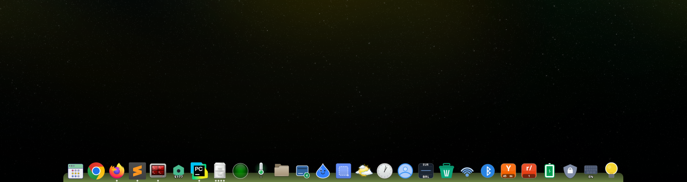
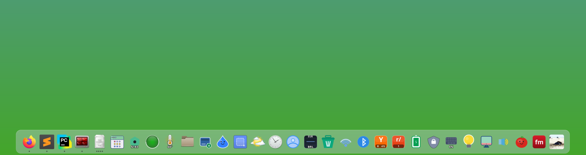

# Docking

[](https://github.com/edumucelli/docking/actions/workflows/ci.yml)
[](https://codecov.io/gh/edumucelli/docking)
[](https://github.com/edumucelli/docking/releases)
[](https://github.com/edumucelli/docking/releases)
[](https://www.python.org/)
[](#requirements)
[](#requirements)
[](LICENSE)
[](https://github.com/edumucelli/docking/commits/master)

A lightweight, feature-rich dock for Linux, FreeBSD, and OpenBSD written in Python with GTK 3 and Cairo. Inspired by [Plank](https://launchpad.net/plank) and [Cairo-Dock](https://github.com/Cairo-Dock), with an extensible applet system for custom widgets.


## Highlights

- Fast launcher workflow with running indicators, previews, app actions, and
  drag-and-drop organization, including pinned files and folder stacks.
- Linux desktop integration across X11 and Wayland, with backend-specific
  capabilities and reduced fallback mode.
- Unified search for applications, windows, recent files, calculations, and paths.
- 65 built-in applets for messaging, media, productivity, system controls, and more.
- Flexible placement across monitors, auto-hide, separators, scalable icons,
  custom icons, and 13 built-in themes.
- AppImage, Debian, RPM, Flatpak, Snap, Arch, and Nix release packages.
- Unity LauncherEntry badges/progress, X11 blur regions, and 74 locale catalogs
  plus English fallback.
- Extensible Python applet system for adding custom dock-resident tools.

## Requirements

- Linux desktop with X11 or Wayland, or FreeBSD/OpenBSD with X11.
- Python 3.10+, GTK 3, and Cairo.

Release packages include or depend on the required runtime libraries. See the
[installation guide](docs/INSTALLATION.md) for source dependencies and the
[Wayland guide](docs/WAYLAND_SUPPORT.md) for compositor requirements and feature coverage.

An [experimental Windows 11 source port](docs/WINDOWS.md) runs the basic dock.
Native desktop integration and feature parity are in progress.

## Installation

Choose the instructions for your system:

- [Debian and Ubuntu (APT)](docs/INSTALLATION.md#debian-and-ubuntu-apt)
- [Fedora and openSUSE (RPM)](docs/INSTALLATION.md#fedora-and-opensuse-rpm)
- [Release downloads and local installation](docs/INSTALLATION.md#release-downloads)
  for AppImage, Debian, RPM, Flatpak, Snap, Arch, and Nix packages.
- [Run from source](docs/DEVELOPMENT.md#source-setup) using pip or uv.
- [FreeBSD and OpenBSD](docs/INSTALLATION.md#freebsd-and-openbsd) package installation instructions.

The [website](https://docking.cc/#install) also provides APT and RPM instructions.

## Running

After installing a system package, launch Docking from your application menu or:

```bash
docking
```

For other package formats, follow the
[package-specific commands](docs/INSTALLATION.md#release-downloads).
Docking selects a backend from the desktop session. GNOME Wayland uses the
companion Shell extension; see the [Wayland guide](docs/WAYLAND_SUPPORT.md) for setup.
Source launches and debug logging are covered in the
[development guide](docs/DEVELOPMENT.md#running).

## First Use

Right-click the shelf background between icons to open the dock menu. Hold
**Ctrl** while right-clicking anywhere on the shelf if the background is hard to hit.

- Open **Preferences** to choose position, monitor behavior, icon size, themes,
  and hiding behavior.
- Choose **Add Applet** or **Add Separator** to extend the dock.
- Right-click a running app -> **Keep in Dock** to pin it, or drop applications,
  files, folders, and AppImages onto the dock.
- Open **Diagnostics** to inspect the capabilities available in your session.

See [First Use](docs/CONFIGURATION.md#first-use) for removing items, custom icons,
folder stacks, and diagnostic reports.

## Global Search

Open **Search...** from the dock menu or add the **Search** applet. Configure a
system-wide shortcut under **Preferences -> Behavior -> Global Search**.
Search applications, windows, files, calculations, conversions, dates, and the web.

Try `Firefox`, `Time in Sao Paulo`, `10 USD to EUR`, or `10 + pi`.
Press **Enter** to open a result, **Ctrl+P** to preview it, or **Ctrl+J** for actions.
See the [Global Search guide](docs/SEARCH.md) for providers and shortcuts.

## Configuration

Open right-click -> **Preferences** to configure appearance, placement, behavior,
applets, and update checks. **Display** moves the dock between monitors.
Settings are saved automatically in `~/.config/docking/dock.json`.

See the [Configuration guide](docs/CONFIGURATION.md) for every setting, pinned
entry formats, per-applet preferences, backups, and safe manual editing.

## Theming

Docking includes thirteen built-in themes and supports custom JSON themes. A few examples:

| Default | Glass | Olive |
|---|---|---|
|  |  |  |

See the [Themes guide](docs/THEMES.md) for the complete gallery, custom-theme
instructions, and theme field reference.

## Applets

Docking includes 65 built-in applets, ranging from application
launchers and system controls to productivity tools, wellness reminders, and
live information.



| Category | Examples |
|---|---|
| Launcher & Navigation | Applications, Search, Run Application, Desktop, WhatsApp, Workspaces |
| Time & Productivity | Clock, Calendar, Alarm, Pomodoro, Calculator, Quick Note |
| System & Power | Devices, Network, Bluetooth, Volume, Battery, System Tray |
| Wellness & Ambient | Hydration, Plant Care, Stretch Coach, Ambient, Pet |
| Information and Environment | Weather, Sunrise, Moon, News, Reddit, Hacker News |

Add one from right-click -> **Add Applet**, then choose a category. See the
[Applets guide](docs/APPLETS.md) for the complete catalog, interactions,
preferences, update intervals, and integration requirements.

## Documentation

| Guide | Contents |
|---|---|
| [Installation](docs/INSTALLATION.md) | Package repositories, downloads, and source dependencies |
| [Wayland](docs/WAYLAND_SUPPORT.md) | Backend support matrix and compositor setup |
| [BSD](docs/INSTALLATION.md#freebsd-and-openbsd) | FreeBSD/OpenBSD package installation |
| [Configuration](docs/CONFIGURATION.md) | First use, preferences, and saved settings |
| [Global Search](docs/SEARCH.md) | Providers, examples, and keyboard controls |
| [Applets](docs/APPLETS.md) | Built-in catalog and applet preferences |
| [Themes](docs/THEMES.md) | Theme gallery and custom JSON themes |
| [Development](docs/DEVELOPMENT.md) | Source setup, tests, and contribution workflow |
| [Custom Applets](docs/APPLET_DEVELOPMENT.md) | Metadata, lifecycle, and implementation examples |
| [Translations](docs/TRANSLATIONS.md) | Locale catalogs and gettext workflows |
| [D-Bus Remote Control](docs/DBUS.md) | Item inspection and control API |
| [Icon Assets and Packaging](docs/ICONS.md) | Application icons and packaging conventions |
| [Packaging](packaging/README.md) | Build commands for all package formats |
| [Visual Compositor Testing](docs/VISUAL_COMPOSITOR_TESTING.md) | Wayland integration testing and findings |

## Contributing

Contributions are welcome. See the [development guide](docs/DEVELOPMENT.md#contributing)
for the pull request workflow and required checks.

## License

[GPL-3.0-or-later](LICENSE)

APT repository hosting is provided free for this open-source project by
[Cloudsmith](https://cloudsmith.com).
