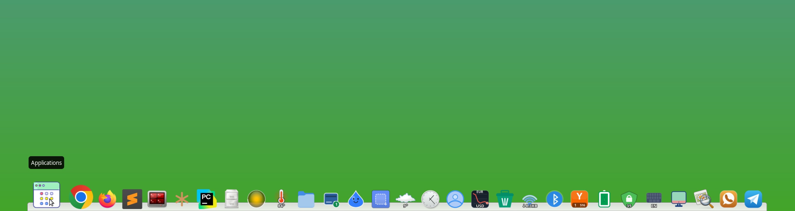

# Docking

[](https://github.com/edumucelli/docking/actions/workflows/ci.yml)
[](https://codecov.io/gh/edumucelli/docking)
[](https://github.com/edumucelli/docking/releases)
[](https://github.com/edumucelli/docking/releases)
[](https://www.python.org/)
[](#requirements)
[](#requirements)
[](LICENSE)
[](https://github.com/edumucelli/docking/commits/master)

[Website](https://docking.cc/) · Watch: [overview tour](https://docking.cc/tours/overview.mp4), [applets tour](https://docking.cc/tours/applets.mp4), [search tour](https://docking.cc/tours/search.mp4), [preferences tour](https://docking.cc/tours/preferences.mp4) · [Install](#installation) · [Features](#highlights) · [Changelog](CHANGELOG.md)

Docking is a desktop dock for Linux (X11 and Wayland), FreeBSD, OpenBSD,
NetBSD, and Windows 11 x64. It uses Python, GTK 3, and Cairo and takes
inspiration from [Plank](https://launchpad.net/plank) and
[Cairo-Dock](https://github.com/Cairo-Dock).


## Highlights

- Drag apps, files, and folders onto the dock to pin them. See which apps are
  running, preview and switch windows, and open app actions from the dock.
- Use the dock on Linux with X11 or Wayland. Window controls and previews
  depend on your desktop session.
- Find apps, windows, recent files, and paths with Global Search. It also
  handles calculations.
- Use 67 built-in applets or write your own in Python.
- Choose a monitor and screen edge, set when the dock hides, and customize it
  with 13 built-in themes, separators, or custom icons.
- AppImage, Debian, RPM, Flatpak, Snap, Arch, and Nix release packages, native BSD
  packages, and a Windows installer and portable ZIP.
- Docking shows badges and progress from Unity LauncherEntry and supports blur
  on X11. It includes 74 locale catalogs and uses English as a fallback.

## Requirements

- Linux desktop with X11 or Wayland, FreeBSD/OpenBSD/NetBSD with composited X11,
  or Windows 11 x64.
- Python 3.10+, GTK 3, and Cairo.

Release packages include or depend on the required runtime libraries. See the
[installation guide](docs/INSTALLATION.md) for source dependencies and the
[Wayland guide](docs/INSTALLATION.md#wayland-support) for compositor requirements and feature coverage.

The [Windows 11 x64 version](docs/INSTALLATION.md#windows-preview) has a per-user
installer and portable ZIP with Python and GTK included. Windows packages are
unsigned; see [Windows coverage](docs/WINDOWS.md) for accepted behavior and limits.

## Installation

Choose the instructions for your system:

- [Debian and Ubuntu (APT)](docs/INSTALLATION.md#debian-and-ubuntu-apt)
- [Ubuntu PPA](docs/INSTALLATION.md#launchpad-ppa) for 22.04, 24.04, and 26.04
  (amd64 and arm64).
- [Fedora and openSUSE (RPM)](docs/INSTALLATION.md#fedora-and-opensuse-rpm)
- [Fedora release RPMs](docs/INSTALLATION.md#fedora-release-packages) for Fedora 44
  and 45 on x86_64 and aarch64.
- [Arch Linux](docs/INSTALLATION.md#arch-linux) for the `docking` package and
  local source builds.
- [Nix flake](docs/INSTALLATION.md#nix) for x86_64 and aarch64 Linux.
- [Release downloads and local installation](docs/INSTALLATION.md#release-downloads)
  for AppImage, Debian, RPM, Flatpak, Snap, Arch, and Nix packages.
- [Run from source](docs/DEVELOPMENT.md#source-setup) using pip or uv.
- [FreeBSD, OpenBSD, and NetBSD](docs/INSTALLATION.md#freebsd-and-openbsd) package installation instructions.
- [FreeBSD Ports](docs/INSTALLATION.md#freebsd-ports) for a local source build.
- [Windows 11 x64](docs/INSTALLATION.md#windows-preview), using the installer
  or portable ZIP when included in a release.

The [website](https://docking.cc/#install) also provides installation instructions.

## Running

After installing a system package, open Docking from your application menu or
run:

```bash
docking
```

For other package formats, follow the
[package-specific commands](docs/INSTALLATION.md#release-downloads).
Docking selects a backend for your desktop session. On GNOME Wayland, follow the
[GNOME Shell bridge setup](docs/INSTALLATION.md#gnome-shell-bridge).
For source launches and debug logging, see the
[development guide](docs/DEVELOPMENT.md#running).

## First use

Right-click between icons to open the dock menu. If there is no room between
icons, hold **Ctrl** and right-click anywhere on the dock.

- Open **Preferences** to choose position, monitor behavior, icon size, themes,
  and hiding behavior.
- Choose **Add Applet** or **Add Separator** to add items to the dock.
- To pin a running app, right-click it and choose **Keep in Dock**. You can
  also drag apps, files, folders, and AppImages onto the dock.
- Open **Diagnostics** to see what your desktop session supports.

See [First use](docs/CONFIGURATION.md#first-use) for removing items, custom icons,
folder stacks, and diagnostic reports.

## Global Search

Open **Search...** from the dock menu or add the **Search** applet. To set a
system-wide shortcut, open **Preferences**, then **Behavior**, and find
**Global Search**. Search for apps, windows, files, and web results, or enter
a calculation, conversion, or date.

Try `Firefox`, `Time in Sao Paulo`, `10 USD to EUR`, or `10 + pi`.
Press **Enter** to open a result, **Ctrl+P** to preview it, or **Ctrl+J** for actions.
See [Global Search](docs/CONFIGURATION.md#global-search) for providers and shortcuts.

## Configuration

Right-click the dock background and choose **Preferences** to change settings.
Choose **Display** from the dock menu to move the dock to another monitor.
Docking saves settings automatically in `~/.config/docking/dock.json`.

See the [Configuration guide](docs/CONFIGURATION.md) for every setting, pinned
entry formats, per-applet preferences, backups, and safe manual editing.

## Theming

Docking includes 13 built-in themes. You can also create your own theme as a
JSON file.

| Default | Glass | Olive |
|---|---|---|
|  |  |  |

See [Themes](docs/CONFIGURATION.md#themes) for the complete gallery, custom-theme
instructions, and theme field reference.

## Applets



| Category | Examples |
|---|---|
| Launcher & Navigation | Applications, Search, Run Application, Desktop, Telegram, WhatsApp, Workspaces |
| Time & Productivity | Clock, Calendar, Alarm, Pomodoro, Calculator, Quick Note |
| System & Power | Devices, Network, Bluetooth, Volume, Battery, System Tray |
| Wellness & Ambient | Hydration, Plant Care, Stretch Coach, Ambient, Pet |
| Information and Environment | Weather, Sunrise, Moon, News, Hacker News |

Right-click the dock background, choose **Add Applet**, then pick a category.
The [Applets guide](docs/APPLETS.md) lists each applet's controls, settings,
update intervals, and requirements.

## Documentation

| Guide | Contents |
|---|---|
| [Installation](docs/INSTALLATION.md) | Linux, BSD and Windows packages, source dependencies, and compositor setup |
| [Windows](docs/WINDOWS.md) | Windows 11 x64, feature coverage, and limitations |
| [Configuration](docs/CONFIGURATION.md) | First use, preferences, Global Search, and themes |
| [Applets](docs/APPLETS.md) | Built-in catalog and applet preferences |
| [Development](docs/DEVELOPMENT.md) | Source setup, tests, custom applets, translations, and D-Bus remote control |
| [Packaging](packaging/README.md) | Build commands for all package formats |
| [Visual Testing](tests/visual/README.md) | Rendering and native desktop checks |

## Contributing

See the [development guide](docs/DEVELOPMENT.md#contributing) for the checks
to run before opening a pull request.

See the [changelog](CHANGELOG.md) for release history and the
[code of conduct](CODE_OF_CONDUCT.md) for community expectations. Report
vulnerabilities privately as described in the [security policy](SECURITY.md).

## License

[GPL-3.0-or-later](LICENSE)

[Cloudsmith](https://cloudsmith.com) hosts the APT repository free of charge.
