# Configuration

Use **Preferences** to change dock settings. Docking checks the values and
applies most changes immediately. You can also edit the JSON settings file by hand.

## First use

Right-click between icons to open the dock menu. If there is no room between
icons, hold **Ctrl** and right-click anywhere on the dock.

- Choose **Preferences** to change how the dock looks and behaves. Choose
  **Display** from the dock menu to move the dock to another monitor.
- Choose **Add Applet** and pick an applet from the menu.
- To insert a separator, right-click where you want it and choose **Add Separator**.
- To pin a running app, right-click it and choose **Keep in Dock**. You can also
  drag applications, `.desktop` files, other files, folders, and AppImages onto
  the dock.
- To remove a pin, right-click it and choose **Remove from Dock**. You can also
  drag an unlocked item off the dock.
- To set a custom icon, right-click a pinned app, file, or folder, open **Icon**,
  and choose **Choose From File...**. The same menu can restore the default icon.
- Open a pinned folder to browse its contents as a stack. Right-click the folder
  to change its display options.

Choose **Diagnostics** from the dock menu to see what your desktop session
supports. **Copy Report** and **Save Report...** include dock placement settings,
monitor geometry, work areas reported by GDK, architecture, and kernel version.
The report lists the features the backend advertises without running feature
tests. Refresh it after changing settings and before attaching it to a bug report.

<a id="configuration-surfaces"></a>

## Settings file

Docking saves preferences in:

```text
~/.config/docking/dock.json
```

Docking creates this file on first run. A new dock starts with the Applications
applet, launchers for common applications found on the system, and the Clock,
Calendar, Weather, System Monitor, Hydration, Notifications, and Session
applets.

Docking writes all supported top-level settings when it saves the file. If you
omit a setting, Docking uses its default.

```json
{
  "icon_size": 48,
  "position": "bottom",
  "hide_mode": "none",
  "theme": "default",
  "pinned": [
    {"kind": "applet", "target": "applet://applications"},
    {"kind": "app", "target": "firefox.desktop"},
    {"kind": "folder", "target": "file:///home/user/Downloads"},
    {"kind": "applet", "target": "applet://clock"}
  ],
  "applet_prefs": {},
  "item_prefs": {}
}
```

## Import a dock layout

On Linux and BSD, Docking offers an import on first launch when it finds a
compatible setup in your XDG configuration directory. Choose a source if both
are present, then review the pins, preferences, and skipped items before
importing. To import later, open **Preferences → Import** and choose
**Plank** or **Cairo-Dock** under **Another dock**. The Plank button also
supports Plank Reloaded.

- **Plank and Plank Reloaded** import the primary dock, including compatible
  launchers, files, folders, docklets, and preferences. With neither its
  GSettings schema nor the `dconf` command available, Docking reads launcher
  files in filename order.
- **Cairo-Dock** imports the main dock in the active theme. It places sub-dock
  contents where the sub-dock icon appeared and converts supported docked
  plug-ins to Docking applets. The review reports skipped custom commands,
  separate docks, and detached desklets.

To import a Docking configuration from another computer or a shared copy, open
**Preferences → Import** and select **Browse…** under **Docking file**. Choose
the copied Docking JSON file (usually named `dock.json`) and review the pins
and layout preferences. Apps and file paths must be available on this computer.
Per-applet settings, custom item icons, keyboard shortcuts, and recent history
stay local.

An import from Preferences appends new pins and applies the reviewed settings
immediately. Docking keeps the previous configuration in its regular
`dock.json.bak` backup and reads the source configuration in place. Theme files
and plug-in-specific preferences need separate setup.

## Settings reference

Boolean defaults are shown as `true` or `false`, matching their JSON values.
Fields described as internal state are maintained by Docking and generally
should not be edited by hand.

### Appearance

| Setting | Default | Values | Description |
|---|---:|---|---|
| `theme` | `"default"` | theme name | Active built-in or user theme. User themes take priority over built-in themes with the same name. |
| `icon_size` | `48` | `32` to `128` px | Base icon size before zoom. Theme proportions scale from this value. |
| `transparency` | `1.0` | `0.15` to `1.0` | Multiplier applied to the theme's dock-background alpha. |
| `zoom_enabled` | `true` | boolean | Enlarges icons near the pointer. |
| `zoom_percent` | `1.5` | `1.0` to `4.0` | Maximum zoom multiplier. `1.5` is 150 percent. |
| `zoom_range` | `3` | integer, minimum `0` | Legacy setting retained for file compatibility. Hover zoom derives its range from the icon size and zoom multiplier. |
| `tooltips_enabled` | `true` | boolean | Shows item names and dynamic details on hover. |
| `window_preview_thumbnails_enabled` | `true` | boolean | Shows window thumbnails when hovering over running applications. |
| `window_preview_highlight_thumbnails_on_hover` | `false` | boolean | Draws a blue border around the preview thumbnail under the pointer. Off by default to keep the popup minimal. Works on every session type. |
| `window_preview_outline_window_on_hover` | `false` | boolean | Outlines the real window on the desktop while hovering its preview thumbnail. Requires an X11 session with a compositing window manager, or Sway; ignored elsewhere. |
| `window_preview_thumbnail_width` | `200` | integer, `120` to `400` | Width in pixels of window preview thumbnails; the height follows a 4:3 ratio and the title length shown under each thumbnail scales with the width. Applied the next time a preview opens. |
| `show_window_count_numbers` | `false` | boolean | Adds a number to a running indicator when an application has multiple windows. |
| `show_launcher_badges` | `true` | boolean | Shows numeric counts reported through launcher integration. |
| `show_launcher_progress` | `true` | boolean | Shows progress reported through launcher integration. |

The Appearance tab groups the thumbnail controls under **Preview**.
Older configuration files using `previews_enabled` or `preview_thumbnail_outline`
are migrated when loaded. The new `window_preview_` keys take precedence when
both names are present, and subsequent saves use only the new names.

See [Themes](#themes) for theme locations, the built-in gallery, and the
custom theme format.

### Placement and monitors

| Setting | Default | Values | Description |
|---|---:|---|---|
| `position` | `"bottom"` | `bottom`, `top`, `left`, `right` | Screen edge used by the dock. |
| `dock_alignment` | `0.5` | `0.0` to `1.0` | Position along the edge: left/top at `0`, center at `0.5`, right/bottom at `1`. Preferences displays this as a percentage. |
| `additional_distance_from_edge` | `0` | `0` to `100` px | Extra gap added to the active theme's own distance from the screen edge. |
| `current_workspace_only` | `false` | boolean | Shows running windows only from the active workspace when the backend supports it. |
| `active_display` | `false` | boolean | Moves the dock to the monitor containing the pointer. |
| `monitor_index` | `-1` | `-1` or non-negative integer | Monitor fallback. `-1` selects the primary monitor. |
| `monitor_connector` | `null` | output name or `null` | Stable monitor connector selected by Docking when the backend exposes one. It is preferred over the numeric index so monitor selection survives display reordering. |

When `active_display` is on, Docking follows the pointer and uses the saved
monitor as a fallback.

To find the **Alignment** slider, open **Preferences** and go to **Placement**
in the **Appearance** tab. Docking keeps the shelf within the space the
compositor gives it, accounting for monitors, panels, dock length, and zoom.
Your saved alignment stays the same when Docking adjusts the position or when
you switch edges or monitors. On hover, the shelf grows evenly from the center
until it reaches a boundary. At either end of the slider, it grows inward.
Docking limits the shelf size and hover zoom near a boundary to keep items clickable.

### Layout

| Setting | Default | Values | Description |
|---|---:|---|---|
| `lock_icons` | `false` | boolean | Prevents reordering, drag-in, and drag-off removal. |
| `pinned_only` | `false` | boolean | Hides unpinned applications, including running apps, recent apps, and launcher-only items. Pinned apps retain their running indicators, windows, and badges. |
| `anchor_applets` | `false` | boolean | Keeps applets grouped at the end of the dock. |
| `anchor_files` | `false` | boolean | Keeps pinned files and folders grouped at the end independently of applets. |

**Preferences → Appearance → Layout → Pinned Only** changes which applications
appear in the dock. It keeps tracking hidden applications and recording recent
history according to the existing recent-app settings. Turning it off restores
the current running and recent items without changing pins or deleting history.

Use **Edit Layout…** in the same section to add, remove, and reorder pinned
applications, applets, files, folders, and separators. Move items within their
anchored sections when anchoring is enabled. The dock previews reordering as you
move items. **Apply** saves the order and applies any additions and removals.
**Cancel** restores the saved order and discards pending edits. Unavailable pins
stay in the editor so you can remove them or keep them for later.

### Mouse, menus, and stacks

| Setting | Default | Values | Description |
|---|---:|---|---|
| `left_click_action` | `"toggle"` | `toggle`, `cycle`, `most-recent` | Left-click behavior for a running application. |
| `middle_click_action` | `"new-window"` | `new-window`, `minimize`, `close-focused` | Middle-click behavior for application items. |
| `dock_item_click_effects_enabled` | `true` | boolean | Plays the selected effect when clicking a dock item launches an application. |
| `dock_item_click_effect` | `"bounce"` | `bounce`, `pulse`, `wobble` | Effect played when a click launches an application: bounce away from the screen edge, briefly grow and settle, or wobble from side to side. The selector is disabled when click effects are off, but its value is retained. |
| `window_list_sort` | `"default"` | `default`, `alphabetical` | Ordering of open windows in application context menus. |
| `stack_unfold` | `"hover"` | `hover`, `click` | Controls whether folder and device stacks open on hover or click. |

Left-click actions behave as follows:

- `toggle` focuses the application, or minimizes its windows when it is already
  focused.
- `cycle` moves focus through the application's open windows.
- `most-recent` focuses the most recently used window, or minimizes when the
  application is already active.

Middle-click actions behave as follows:

- `new-window` asks the application to open a new window when supported.
- `minimize` minimizes all open windows belonging to the application.
- `close-focused` closes the application's focused window.

### Hiding and revealing

| Setting | Default | Values | Description |
|---|---:|---|---|
| `dock_shortcut` | `""` | captured shortcut | Shortcut used by Show Only with Shortcut mode; assign one in Preferences before enabling the mode. |
| `hide_mode` | `"none"` | see below | Controls hiding, window stacking, and screen-space reservation. |
| `hide_delay_ms` | `0` | integer, minimum `0` | Wait before hiding after the pointer leaves. |
| `unhide_delay_ms` | `0` | integer, minimum `0` | Wait before showing after the pointer returns. |
| `hide_time_ms` | `250` | integer, minimum `0` | Hide and show slide-animation duration. This is currently file-only. |
| `pressure_reveal_enabled` | `false` | boolean | Requires pointer pressure at the screen edge before revealing a hidden dock. This is available when the X11 pointer-barrier backend supports it. |
| `pressure_threshold` | `50` | `5` to `500` px | Amount of resisted pointer movement required to reveal the dock. Higher values reduce accidental reveals. |

Hide modes:

- `none` keeps the dock visible and reserves screen space for it.
- `always-on-top` keeps the dock visible above windows without reserving screen
  space.
- `always-behind` keeps the dock above the desktop and below application windows,
  without reserving screen space. Minimize, resize, or shade a covering window
  to use the dock. Edge hover, pointer pressure, and the dock shortcut do not
  bring it forward. Hide delays and pressure settings are retained but inactive.
  Choose **Always behind** in **Preferences -> Behavior**. On GNOME
  Wayland, reinstall the bundled Shell bridge and restart the session after
  upgrading an older bridge. Reduced integration can only request GTK stacking
  hints; the compositor decides whether to honor them.
- `autohide` hides the dock whenever the pointer leaves it.
- `shortcut-only` keeps the dock hidden until its shortcut is pressed. It waits
  for the pointer to enter, then hides after the pointer leaves; pressing the
  shortcut again also hides it. Edge hover and pressure cannot reveal it.
  Select **Show Only with Shortcut** in **Preferences -> Behavior** to reveal
  the **Dock Shortcut** field, then assign a working shortcut to enable the mode.
  If registration fails or is lost, Docking temporarily uses Auto-hide and
  explains the failure in the shortcut field's tooltip. Reassign the shortcut
  to attempt registration again. The saved hide mode is preserved.
  Desktop fullscreen stacking still applies, so switching away from a fullscreen
  application may be necessary before the dock can appear.
- `intelligent` hides when a window belonging to the focused application
  overlaps the dock.
- `dodge-active` hides when the focused window overlaps the dock.
- `window-dodge` hides when any window on the active workspace overlaps the
  dock.
- `dodge-maximized` hides when the focused window is maximized or a dialog
  overlaps the dock.

Some hide modes depend on the current desktop backend's window tracking. Use
**Diagnostics** to see which integration is active in the current session.

### Startup and updates

On a native Linux installation, turn on **Start at Login** under
**Preferences → Behavior** to open Docking automatically when you sign in to a
desktop that supports XDG autostart. The switch is off by default. Turning it
off leaves Docking open for the current session.

| Setting | Default | Values | Description |
|---|---:|---|---|
| `startup_tips_enabled` | `true` | boolean | Allows one usage tip after startup when no higher-priority startup notice is shown. |
| `update_check_enabled` | `true` | boolean | Checks GitHub for newer Docking releases. |
| `update_check_interval_hours` | `24` | integer, minimum `1` | Minimum time between automatic checks. Preferences offers daily (`24`) and weekly (`168`). |

Update-check timestamps, ignored releases, and reminder state are runtime state
stored separately in:

```text
~/.local/state/docking/updates.json
```

### Global Search settings

| Setting | Default | Values | Description |
|---|---:|---|---|
| `global_search_enabled` | `true` | boolean | Enables the shared search palette, D-Bus activation, and XDG GlobalShortcuts registration. |
| `global_search_shortcut` | `CTRL+ALT+space` | captured shortcut | Preferred portal trigger and the active X11 fallback sequence. The desktop portal may retain or assign a different trigger. |
| `global_search_web_engine` | `duckduckgo` | `duckduckgo`, `google`, `brave`, or `bing` | Engine used by fallback searches. |

Click the shortcut button in **Preferences -> Behavior -> Global Search**, then
press the desired sequence. On Wayland, the assignment belongs to the desktop
portal, which may retain or assign a different trigger. On X11, Docking uses
the captured sequence directly when the portal is unavailable.

Relevance privacy, previews, and provider behavior are documented in
[Global Search](#global-search).

### Recent applications and documents

| Setting | Default | Values | Description |
|---|---:|---|---|
| `show_recent_apps` | `true` | boolean | Shows recently closed applications between pinned and currently running items. Disabling it clears the saved recent-app history. |
| `recent_apps_max` | `5` | `1` to `15` | Maximum recent application icons to retain and display. |
| `recent_apps_retention_days` | `14` | `1` to `90` days | Removes applications after this many days without use. Preferences offers 3, 7, 14, and 30 days. |
| `recent_apps` | `[]` | list | Internal recent-app history maintained by Docking. Each entry contains a desktop ID and a Unix `last_closed` timestamp. |
| `show_recent_docs_in_menu` | `true` | boolean | Adds a Recent Documents submenu to application context menus. |
| `recent_docs_max` | `10` | `1` to `25` | Maximum recent documents shown for each application. |

## Pinned items

`pinned` is the ordered list of permanent dock entries. Docking normally
updates it through pin, remove, add-applet, and drag-and-drop actions.

```json
{
  "pinned": [
    {"kind": "applet", "target": "applet://applications"},
    {"kind": "app", "target": "firefox.desktop"},
    {"kind": "folder", "target": "file:///home/user/Downloads"},
    {"kind": "file", "target": "file:///home/user/Documents/notes.txt"},
    {"kind": "applet", "target": "applet://clock"}
  ]
}
```

Each entry has two fields:

| `kind` | `target` format | Meaning |
|---|---|---|
| `app` | desktop file ID such as `firefox.desktop` | Application launcher. |
| `applet` | `applet://<id>` | Built-in applet. Some repeatable applets use an instance suffix such as `#2`. |
| `file` | absolute `file://` URI | Pinned file. |
| `folder` | absolute `file://` URI | Pinned folder displayed as a stack. |

Docking converts plain strings in older files to this format when it loads them.

Right-click a folder to browse its contents. **Open Folder**, **Open in Terminal**,
**Open With…**, sorting, and hidden-file controls appear before the contents,
including in nested folder menus. Display settings belong to the pinned folder
and apply throughout its browsing tree.

Right-click an entry inside a folder menu, or select it and press the Menu key
or Shift+F10, to open commands for that entry. Files also offer **Open With…** in
their dock context menus. Linux and BSD use the GTK application chooser; Flatpak
uses the host desktop portal. Windows uses its system application chooser for
files. The Windows chooser can remain open after Docking exits. Press Escape to
dismiss it. Terminal opening uses the selected folder as its
working directory; Windows opens Windows PowerShell in a new console.

## Per-applet and per-item preferences

`applet_prefs` is a map keyed by applet ID or applet instance. Its contents are
owned by each applet and can include locations, units, timers, display modes,
and other applet-specific values. Configure these through the applet's context
menu or the **Applets** preferences tab whenever that applet exposes controls.

AI Usage keeps its history in `$XDG_STATE_HOME/docking/aiusage.json`, defaulting
to `~/.local/state/docking/aiusage.json` on Unix and
`%LOCALAPPDATA%\State\docking\aiusage.json` on Windows. Its hooks do not write
`dock.json`; existing AI usage preferences are imported on the first refresh.

`item_prefs` is keyed by a stable item target. Docking currently uses it for
settings such as custom icon source/path and folder-stack sorting or hidden-file
visibility. These maps are intentionally open-ended so new applet or item
preferences do not require a new top-level configuration field.

## Manual editing and recovery

Quit Docking before editing `dock.json`. Docking can overwrite the file while
it runs. Save it as valid JSON, then restart Docking.

When Docking loads the file, it checks the settings:

- It limits numeric settings to their allowed range.
- It uses defaults for invalid choices.
- It discards malformed pinned and recent-app entries.
- It ignores unknown top-level keys.

Configuration saves are atomic. Before replacing an existing valid file,
Docking keeps the previous version at:

```text
~/.config/docking/dock.json.bak
```

If Docking cannot load the main file, it tries the backup. It uses defaults
only if both files are unusable. Docking also reads the older
`folder_stack_unfold` key when `stack_unfold` is absent.

## Global Search

Open **Search...** from the dock menu, use the [Search applet](APPLETS.md#search),
or set a system-wide shortcut in [Global Search settings](#global-search-settings).
Type a name, expression, date, path, or web query directly. Use the [keyboard
controls](#keyboard-controls) to open, preview, or act on results.

Calculations support scientific notation, exponentiation (`2^8`), modulo,
constants such as `pi`, and common functions such as `sqrt`, `sin`, and `log`.

For currency conversions, Docking uses a table of EUR-based rates from
Frankfurter. The request omits your amount and currency pair. Docking caches
the rates for one hour and refreshes them in the background.

Time-zone queries accept every IANA zone installed on the system. Use a full
identifier such as `time in America/New_York`, or an unambiguous location name
such as `time in Kathmandu`. Spaces, letter case, underscores, and accents are
normalized. When a short location name belongs to more than one installed zone,
use its region-qualified identifier.

Date and time queries include `date`, `time`, `in 3 days`, `2 weeks ago`,
`next Monday`, and UTC offsets such as `time in UTC+05:30`. Prefix a time-zone
conversion with an ISO date when daylight-saving rules for a specific day
matter, for example `2026-12-01 10:00 Paris to Tokyo`.

### Provider examples

Search checks applications, dock items, windows, and recent files together.
It runs calculators and other utilities when it recognizes the query format.

| Provider | Example queries | What the result can do |
|---|---|---|
| Applications | `firefox`, `image editor` | Open or focus an application, open a new window or desktop action, pin or unpin it, close its windows, and refine into individual windows or recent documents. |
| Dock Items | `clock`, `report` | Open pinned files and folders, activate applets, or remove an item from the dock. Application launchers are handled by the Applications provider. |
| Windows | `project plan`, `terminal` | Find windows by title or application identity, activate them, close them, and preview them when the desktop backend supports capture. |
| Calculator | `2^8`, `sqrt(81) + pi`, `1e3 / 4`, `17 % 5` | Evaluate safe arithmetic and common scientific functions, then copy the result. Prefix with `=` to force calculator interpretation. |
| Converter | `10 km to miles`, `32 F to celsius`, `10 USD to EUR` | Convert supported length, weight, volume, temperature, speed, time, data, and live currency values, then copy the result. |
| Recent Files | `proposal`, `invoice` | Search the desktop's recent-file history, open a result, and preview supported local content. |
| Date & Time | `date`, `time`, `in 3 days`, `next Monday`, `time in Kathmandu`, `10:00 UTC to New York` | Show and copy dates, relative dates, local or remote times, and time-zone conversions. |
| Direct Paths | `~/Downloads`, `/etc/hosts`, `file:///home/user/report.pdf` | Open an existing file or folder, copy its path, and preview supported local content. |
| Web | `docs.python.org`, `user@example.com`, `What is a Linux dockbar?` | Open detected URLs, compose email, or offer a search using the configured engine when local results are weak. |

### Keyboard controls

- **Enter:** run the primary action.
- **Ctrl+Right:** refine the selected application into actions, individual
  windows, and recent documents.
- **Ctrl+J:** open the standard Action Panel.
- **Ctrl+P:** toggle the result preview.
- **Esc:** close the active panel, then the palette.

### Relevance learning and privacy

Search gives a small boost to results and actions you choose often, recently,
or for that query. Stronger text matches still rank higher. Docking stores
SHA-256 hashes as pseudonymous identifiers and omits the original queries,
result titles, file paths, and document names.

```text
~/.local/state/docking/search-usage.json
```

### Previews

Press **Ctrl+P** to preview the selected result. Search loads previews lazily:

- live backend captures for preview-capable windows;
- application state, windows, actions, and recent documents;
- aspect-correct image thumbnails and metadata;
- bounded text, source-code, and readable Markdown excerpts;
- bounded ZIP and TAR member listings without extraction;
- directory listings and script source.

Large, binary, unsupported, or failed previews fall back to safe metadata.

## Themes

Docking includes thirteen themes and supports custom themes stored as JSON files.

### Built-in themes

| Candy | Default |
|---|---|
| 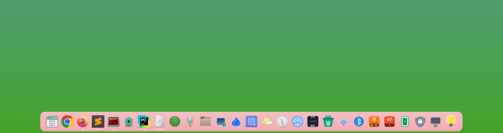 | 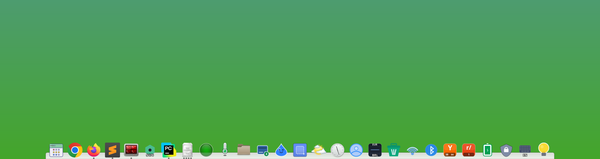 |
| Ember | Glass |
| 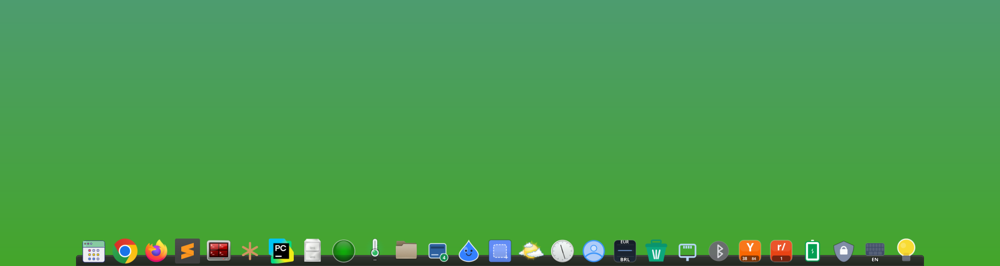 | 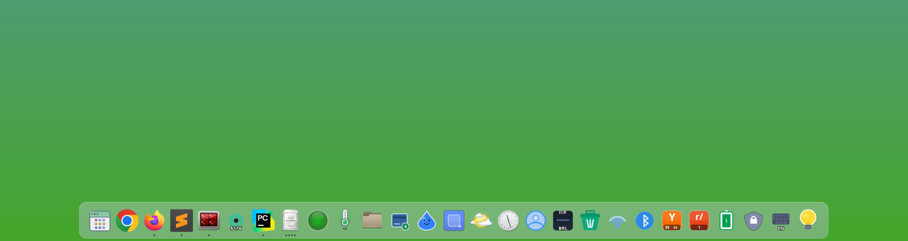 |
| Gruvbox | Nord |
| 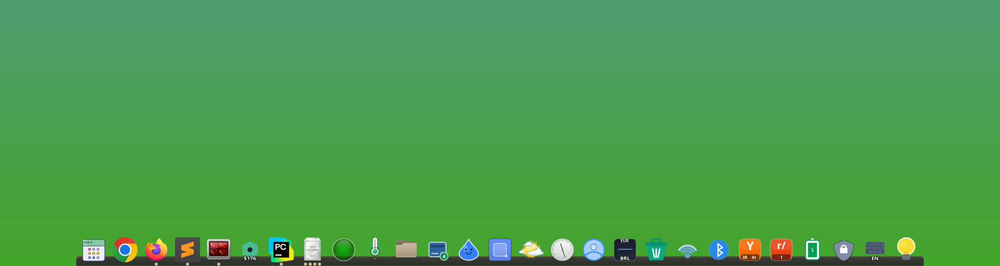 | 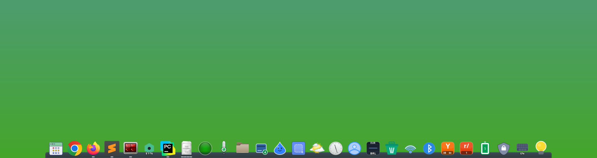 |
| Olive | Onyx |
| 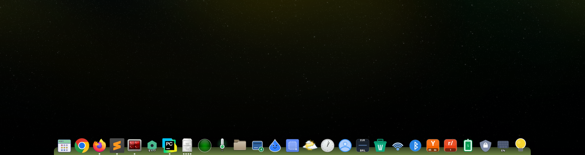 | 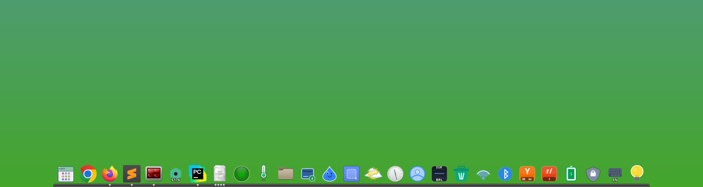 |
| Paper | Pill |
| 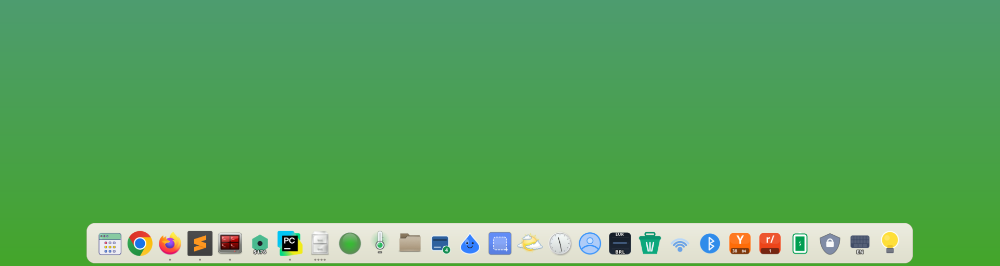 | 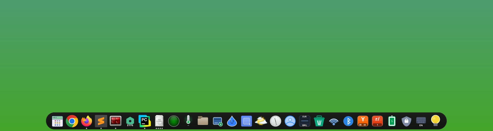 |
| Slate | Solarized |
| 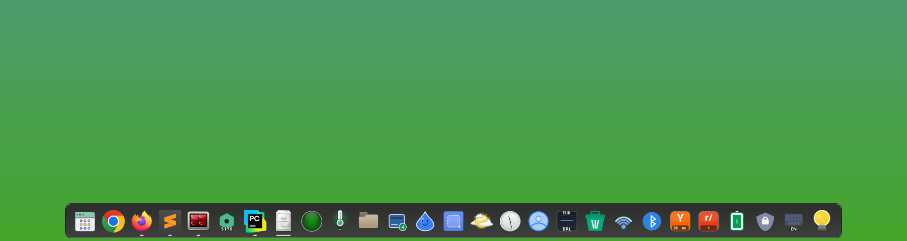 | 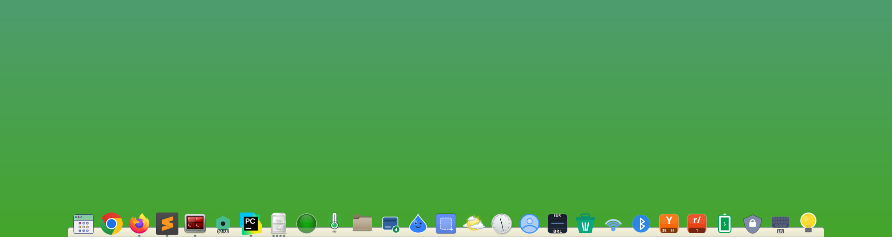 |
| Transparent | |
| 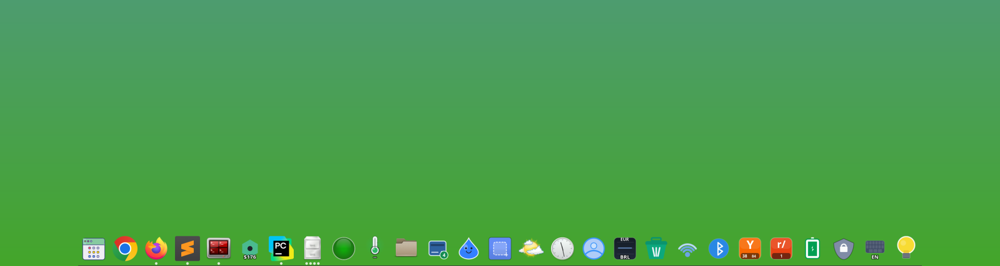 | |

### Theme files

Docking loads user themes from:

```text
~/.config/docking/themes/
```

It then falls back to the [built-in theme JSON files](../docking/assets/themes/).
Layout scale units are tenths of a percent of `icon_size`.

Theme field names use suffixes to make value types clear:

- `_px` means a raw pixel value in JSON/runtime, such as
  `shelf.stroke_width_px` or `layout.distance_from_edge_px`.
- No unit suffix means a theme scale unit in JSON, converted to pixels at
  runtime, such as `layout.horizontal_padding`, `layout.top_padding`,
  `layout.bottom_padding`, and `layout.item_padding`.
- `_ms` means milliseconds.
- `_ratio` means a relative fraction, such as a bounce height relative to icon
  size.
- `_color` means an RGBA color array stored as `[red, green, blue, alpha]` in
  0-255 values.

Boolean, enum/string-choice, and count fields are exceptions and stay semantic
without a type suffix, for example `shelf.round_bottom`, `indicators.style`,
and `indicators.max_dots`.

Use `layout.distance_from_edge_px` to set the gap between the dock and the
screen edge. Floating themes such as `slate` use this setting.

Docking converts older flat fields such as `h_padding` when it loads a user theme.

### Theme fields

#### Shelf

`shelf.*` controls the dock background bar:

| Key | Default | Values | Notes |
|---|---|---|---|
| `shelf.fill_start_color` | `[222, 222, 222, 240]` | `[r, g, b, a]` (0-255) | Top color of the shelf vertical gradient. |
| `shelf.fill_end_color` | `[247, 247, 247, 240]` | `[r, g, b, a]` | Bottom color of the shelf gradient. |
| `shelf.stroke_color` | `[145, 145, 145, 255]` | `[r, g, b, a]` | Outer border color. |
| `shelf.stroke_width_px` | `1.0` | px | Outer border thickness. |
| `shelf.inner_stroke_color` | `[248, 248, 248, 255]` | `[r, g, b, a]` | Inset highlight stroke drawn 1px inside the outer border. |
| `shelf.corner_radius_px` | `5` | px | Rounded-corner radius. |
| `shelf.round_bottom` | `false` | bool | Round the bottom corners too (vs. square flush with the screen edge). |

#### Layout

`layout.*` controls item placement and edge spacing. Values use scale units
unless suffixed:

| Key | Default | Values | Notes |
|---|---|---|---|
| `layout.horizontal_padding` | `0` | scale units | Gap on each side of the item run. Values `<= 0` fall back to `2 * stroke_width`. |
| `layout.top_padding` | `-7` | scale units | Vertical offset of the shelf top relative to the icon top. Negative values make icons overflow above the shelf. |
| `layout.bottom_padding` | `1` | scale units | Gap between the shelf bottom and the screen edge. |
| `layout.item_padding` | `2.5` | scale units | Horizontal gap between adjacent icons. |
| `layout.distance_from_edge_px` | `0` | px | Gap between the dock and the screen edge. Floating themes (e.g. `slate`, `pill`) use this to lift the dock away from the edge. User setting `additional_distance_from_edge` is added on top of this. |

#### Indicators

`indicators.*` controls running-app indicators below each icon:

| Key | Default | Values | Notes |
|---|---|---|---|
| `indicators.style` | `"dots"` | `"dots"`, `"dashes"` | Indicator shape under running apps. |
| `indicators.fill` | `"flat"` | `"flat"`, `"glow"` | Rendering style. `flat` is a solid disc/line; `glow` is a soft radial halo around each dot/dash. |
| `indicators.inactive_color` | `[80, 80, 80, 200]` | `[r, g, b, a]` | Color for running but not focused. |
| `indicators.active_color` | `[50, 50, 50, 255]` | `[r, g, b, a]` | Color for the currently focused app. |
| `indicators.size_px` | `5` | px | Indicator diameter (radius = `size_px / 2`). |
| `indicators.max_dots` | `4` | int | Maximum number of dots shown when an app has multiple windows. Above this, a count badge is drawn. |

#### Hover effects

`items.hover.*` controls the hover lighten effect:

| Key | Default | Values | Notes |
|---|---|---|---|
| `items.hover.lighten_amount` | `0.2` | 0.0-1.0 | Additive brightness applied to the hovered icon. |
| `items.hover.fade_ms` | `150` | ms | Fade in/out duration for the hover lighten. |

#### Bounce animations

`items.bounce.*` controls icon bounce animations:

| Key | Default | Values | Notes |
|---|---|---|---|
| `items.bounce.urgent_height_ratio` | `1.66` | fraction of `icon_size` | Peak height of the urgent-window bounce. |
| `items.bounce.urgent_time_ms` | `600` | ms | Duration of one urgent bounce. |
| `items.bounce.launch_height_ratio` | `0.625` | fraction of `icon_size` | Peak height of the app-launch bounce. |
| `items.bounce.launch_time_ms` | `600` | ms | Duration of one launch bounce. |
| `items.bounce.click_time_ms` | `300` | ms | Duration of the click feedback bounce. |

#### Glow effects

`items.glow.*` controls the active-app shelf glow and urgent halo:

| Key | Default | Values | Notes |
|---|---|---|---|
| `items.glow.active_shape` | `"linear"` | `"linear"`, `"radial"`, `"flat"` | `linear` = vertical gradient under the icon (default). `radial` = halo centered behind the icon. `flat` = solid color fill. |
| `items.glow.active_tint` | `"icon"` | `"icon"`, `"theme"` | `icon` = tint the glow with the icon's averaged color. `theme` = use `items.glow.active_color`. |
| `items.glow.active_color` | mirrors `indicators.active_color` | `[r, g, b, a]` | Consumed only when `active_tint = "theme"`. |
| `items.glow.active_opacity_ratio` | `0.6` | 0.0-1.0 | Maximum alpha of the active-app glow gradient (linear/radial) or solid fill (flat). |
| `items.glow.urgent_time_ms` | `10000` | ms | How long the urgent halo around an icon stays visible after the urgent flag is set. |
| `items.glow.urgent_pulse_ms` | `2000` | ms | One pulse cycle period for the urgent halo. |
| `items.glow.urgent_size_ratio` | `0.6` | fraction of `icon_size` | Radius of the urgent halo. |

### Creating a custom theme

- Docking creates `~/.config/docking/themes/template.json` on startup.
- Copy `template.json` to a new name, such as `my-theme.json`, then edit it.
- `template.json` is hidden from the selector; renamed `.json` files appear as
  themes.
