# Windows support

Windows support is being implemented incrementally on `feature/windows-port`.
The target is the complete dock, with feature parity measured against the
Linux implementation. A startup or unit-test pass does not establish parity.

## First target

Start with **Windows 11 Pro 25H2, x64**, using the normal Microsoft installation
media. Microsoft currently supplies this image through its Windows download
service, and 25H2 remains supported through October 2027. Pro provides RDP for
development; Docking's shared features should also work on Home. Windows 10's
standard support ended in October 2025, so it is a later compatibility target.
Windows 11 26H2 is a follow-up verification target. Version 26H1 targets new
hardware and is not the appropriate general desktop baseline.

Sources: [Windows 11 release information](https://learn.microsoft.com/en-us/windows/release-health/windows11-release-information),
[Windows 10 lifecycle](https://learn.microsoft.com/en-us/lifecycle/announcements/windows-10-end-of-support).

## Development runtime

Use native Windows Python and GTK 3 from MSYS2 **UCRT64**. The MSYS Unix Python
and WSL exercise different operating-system interfaces and do not validate this
port. The existing Cairo renderer, GTK UI, themes, configuration and applet model
remain the product implementation.

In a UCRT64 shell:

```sh
pacman -Syu
pacman -S --needed mingw-w64-ucrt-x86_64-gtk3 \
  mingw-w64-ucrt-x86_64-python mingw-w64-ucrt-x86_64-python-gobject \
  mingw-w64-ucrt-x86_64-python-cairo mingw-w64-ucrt-x86_64-python-pip \
  mingw-w64-ucrt-x86_64-python-psutil mingw-w64-ucrt-x86_64-python-numpy \
  mingw-w64-ucrt-x86_64-python-pillow mingw-w64-ucrt-x86_64-gstreamer \
  mingw-w64-ucrt-x86_64-gst-plugins-base \
  mingw-w64-ucrt-x86_64-gst-plugins-good mingw-w64-ucrt-x86_64-gst-plugins-bad
python -m pip install --break-system-packages 'openmeteo-requests>=1.2,<1.5' requests-cache retry-requests
python -c "import gi; gi.require_version('Gst', '1.0'); from gi.repository import Gst; Gst.init(None)"
python run.py
```

References: [GTK on Windows](https://www.gtk.org/docs/installations/windows/),
[MSYS2 environments](https://www.msys2.org/docs/environments/).

MSYS2 Python's C-extension ABI differs from standard Windows CPython. Native
extensions come from pacman. The Windows Open-Meteo dependency uses the
requests-based client releases to avoid building the newer client's qh3
dependency; the forecast API remains the same. See
[MSYS2 Python compatibility](https://www.msys2.org/docs/python/) and
[Open-Meteo 1.4 dependency metadata](https://pypi.org/project/openmeteo-requests/1.4.0/).

## Backend boundaries

Shared UI and state use backend contracts with platform implementations.
For Network, `applets/network/backend.py` defines `NetworkBackend` and its
settings actions; `linux.py`, `bsd.py` and `windows.py` implement that contract.
The applet uses the contract for state, traffic, adapter choices and settings.
Unix desktop command
discovery is shared by Linux and BSD in `desktop_settings.py`; IP Helper bindings
and adapter selection belong to the Windows implementation.
`windows_connections.py` implements the shared `ConnectionManager`, delegating
WLAN calls to `windows_wifi.py` and VPN actions to `windows_vpn.py`/`windows_ras.py`.

Window tracking follows the common `WindowService` contract in
`platform/backends/base.py`. Win32 enumeration and actions are implemented in
`platform/backends/windows/windows.py`. Platform-neutral snapshot projection and
application matching live in `window_projection.py`, used by KWin, Sway and
Windows. `windows/ffi.py` contains only small Win32 ABI
primitives needed by several Windows implementations.

Battery follows `BatteryBackend` for aggregate readings, power, peripherals and
Power Settings. The shared UI keeps one backend instance and passes no sysfs
paths to it. Linux owns its device/path configuration; Linux and BSD use the
UPower implementation for accessories. Windows uses its power APIs and native
Settings action; accessory discovery remains incomplete. Shared battery state
and tooltip formatting contain no OS access.

Volume's `VolumeBackend` supplies optional audio controls and settings actions.
Linux, BSD and Windows construct the same contract, so Sound Settings remain
available when no mixer tool is installed. CLI parsing belongs to the ALSA or
PulseAudio implementation; native Core Audio and the Windows Settings action
belong to `volume/windows.py`.

## Repeatable Windows desktop lab

`packaging/windows/lab/compose.yaml` pins the Dockur image used by this port.
Use a local official Windows 11 x64 ISO. The lab keeps its disk, screenshots
and jobs outside the source checkout. Its browser, VNC and RDP ports bind only
to localhost. The bootstrap installs Python/GTK and starts a lab agent in the
logged-in Windows user's desktop session.

Set these variables in a private environment file:

```ini
DOCKING_WINDOWS_STORAGE=/absolute/path/to/persistent/storage
DOCKING_WINDOWS_SHARE=/absolute/path/to/shared/artifacts
DOCKING_WINDOWS_SOURCE=/absolute/path/to/windows/worktree
DOCKING_WINDOWS_ISO=/absolute/path/to/official-windows11-x64.iso
DOCKING_WINDOWS_PASSWORD=choose-a-local-lab-password
```

```sh
docker compose --env-file /path/to/lab.env \
  -f packaging/windows/lab/compose.yaml \
  -f packaging/windows/lab/compose.install.yaml up -d
python tools/windows_lab.py --share /path/to/shared/artifacts configure-share
python tools/windows_lab.py --share /path/to/shared/artifacts ready
python tools/windows_lab.py --share /path/to/shared/artifacts --wait 5 run \
  'C:\msys64\ucrt64\bin\pythonw.exe' \
  '\\host.lan\Data\repo\tools\windows_smoke.py' \
  --output '\\host.lan\Data\lab\smoke'
```

Jobs receive unique IDs and durable response files under `lab/jobs`. If a host
command times out, inspect the response and heartbeat before submitting another
job. Do not launch a second copy merely because observation timed out.
An agent restart does not replay a claimed job whose outcome is unknown.

Run `configure-share` after each container startup, before submitting jobs.
It disables SMB leases for this dedicated lab and reconnects the lab clients,
so host edits and new job files reach Windows promptly. It leaves Windows
running. The agent retries temporary SMB publication errors while retaining
the completed result.

After the installed Windows desktop has completed setup, stop the container
gracefully and confirm `storage/windows.boot` exists. Subsequent starts use only
`compose.yaml`, without the install overlay. After verifying that boot, the
original ISO can be deleted. Keep the installed disk and firmware files.
The desktop and lab agent were checked after an ISO-free restart. A source
launch immediately after login exceeded the smoke test's 40-second startup
limit; a subsequent import probe took 19.5 seconds over SMB. Packaging and
startup performance remain acceptance work.
Once login settled, the same 40-second smoke check passed again, including
Preferences, persisted resizing, taskbar-safe placement and normal Quit.

The smoke test runs the complete application and records desktop PNGs, native
Win32 window geometry, focus observations, input results and application logs.
An offscreen render is useful for renderer regressions but is not a Windows
desktop acceptance result. Inspect the captured PNGs as well as the assertions.

## First desktop evidence

On October 25, 2026, the complete source application ran on **Windows 11 Pro
25H2, build 26200.8037**, with native UCRT64 Python **3.14.9** and GTK **3.24.52**.
The baseline is one 1280×800 monitor at 96 DPI, with Explorer's taskbar visible.
`smoke-mouse-ui` captured the desktop at startup, during magnification, with
the context menu open, and with Preferences open. Native input opened those
surfaces and selected Quit; the process exited with code 0 without termination.
Hover did not change the foreground window. Ten focused Windows tests passed,
including configuration save/backup and native application metadata contracts.
Gio discovered 184 application records. A subsequent `smoke-workarea` run edited icon size from
48 to 64 through Preferences, verified the persisted JSON value, and checked
the resized native window against Explorer's work area before quitting cleanly.
The larger dock remained fully above the taskbar.

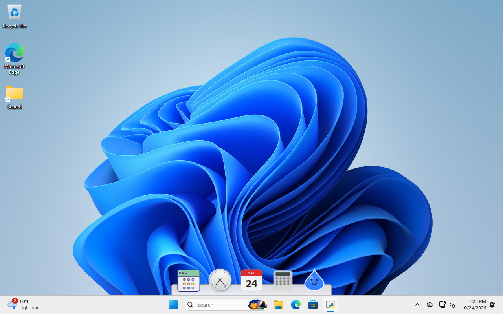

The next desktop milestone adds native `EnumWindows` snapshots, packaged-app
identity through `GetApplicationUserModelId`, normal executable identity,
running indicators, and activate/minimize/close actions. Packaged launches use
the Windows activation manager and pass the user's foreground privilege to it.
Shell icons are extracted on two background workers, then published to GTK.

`windows-native-verified` launched Notepad by clicking its pinned icon, checked
that its window became foreground, clicked the running icon to minimize it,
clicked again to restore and activate it, and selected Close in the item menu.
Independent Win32 observations confirmed every transition. The dock then quit
through its own menu without process termination. Captures also show Notepad's
native icon and running indicator. The baseline remains the same single display.
Fourteen focused tests also passed under native Windows Python. Repeating shell
icon extraction 26 times left the process's GDI handle count unchanged at 40.

System Tray now selects a native Windows backend and no longer imports
XEmbed/GdkX11 on Windows. Its shared GTK presentation, service and menu models
use the same contracts as the Linux implementation.
Importing a class does not verify its controls or native system backend; the
catalog acceptance work remains open.

```sh
python tools/windows_lab.py --share /path/to/shared/artifacts run \
  'C:\msys64\ucrt64\bin\pythonw.exe' \
  '\\host.lan\Data\repo\tools\windows_window_smoke.py' \
  --output '\\host.lan\Data\lab\windows-native'
```

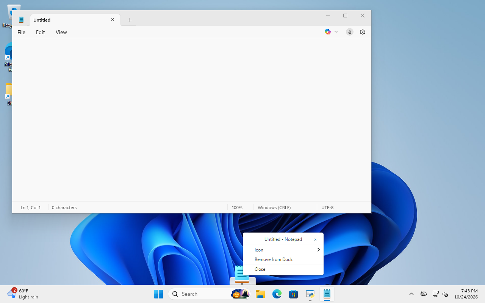

The smoke tool's mouse row coordinates assume that baseline theme and DPI.
The initial checks exposed keyboard navigation and native WM_CLOSE failures
while a menu grab was active. The scoped menu integration described below
addresses those failures; the initial mouse-only evidence did not cover them.

## Desktop reservation and overlap

The Windows surface now uses the native shell AppBar protocol. A transparent,
non-interactive proxy window reserves only the resting shelf; the GTK window
retains its larger animation area. Explorer's taskbar stays at the outer edge.
Shell position/display notifications schedule a coalesced placement refresh,
and shutdown unregisters the AppBar before destroying its proxy.

The reservation phase of `windows-desktop-acceptance` ran the complete dock at
all four edges. At the baseline 48-pixel icon size each edge reserves 53 pixels, while its animation
surface extends 187 pixels. Independent GetMonitorInfo observations verify the
reserved work area, and a maximized blank Notepad follows it. The test records
Notepad's existing native resize margins before comparing its client geometry;
those invisible margins differ from the visible content boundary. Every normal
dock shutdown restores the original `[0, 0, 1280, 752]` work area exactly.
The captured top, bottom, left and right desktops were visually inspected.

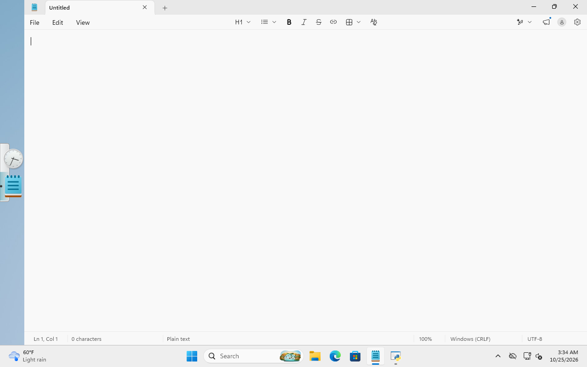

`windows-visibility-native-pointer` passed all six non-reserving modes:
always-on-top, autohide, dodge-active, window-dodge, intelligent and
dodge-maximized. Independent screenshot crops establish hidden/visible states;
all hidden crops matched the covered desktop exactly. In each mode, edge hover
revealed the dock without taking foreground focus from Notepad. Minimizing
Notepad exposed the dock in the overlap modes, while autohide remained hidden.
Closing every test dock left Explorer's original work area intact.

The checks found and fixed startup autohide when the pointer was already
outside the dock. They also established that GTK's input-shape method is a no-op
on Windows. The surface observes the native pointer to reveal a fully transparent
hidden edge, using the renderer's current input rectangle. This fallback does
not confine the pointer or implement pressure barriers; those capabilities
remain disabled. See the [GTK input-shape documentation](https://docs.gtk.org/gdk3/method.Window.input_shape_combine_region.html).

Fifty-two focused tests passed under native Windows Python. The Notepad
launch/minimize/restore/Close desktop check also passed again with reservation
enabled and normal dock shutdown. The baseline remains one display at 96 DPI.
A separate native full-screen GTK fixture was tracked as fullscreen (and not
maximized), with independent Win32 bounds of `[0, 0, 1280, 800]`. Fullscreen
stacking, restart races and broader application/dialog behavior
still need desktop acceptance.

Window overlap is evaluated in the dock monitor's GTK coordinate space. Raw
Win32 geometry is projected relative to the native monitor origin and scale;
owned dialogs participate in overlap without receiving a separate taskbar icon.
Negative-origin and scaled geometry have unit coverage. Actual mixed-DPI and
multiple-monitor acceptance remains pending.

```sh
python tools/windows_lab.py --share /path/to/shared/artifacts --timeout 600 run \
  'C:\msys64\ucrt64\bin\pythonw.exe' \
  '\\host.lan\Data\repo\tools\windows_desktop_smoke.py' \
  --output '\\host.lan\Data\lab\windows-desktop'
```

The desktop tool owns a blank Notepad fixture, uses isolated dock settings, and
stops before running if an existing dock or Notepad window is open. Its pixel
comparisons target the documented single-display baseline. It records actual
screenshots, native work areas and independent foreground-window observations.

## Native window previews

Windows previews use `Windows.Graphics.Capture` with an HWND capture item and
a free-threaded frame pool. One worker owns the WinRT apartment, Direct3D11
device, capture sessions, GPU textures and mapped readback memory. GTK receives
copied RGBA pixels through its main loop; hovering never calls another
application's paint handler or waits for capture on the UI thread.

The service keeps at most four native streams, expires unused streams after
1.5 seconds, and bounds the image cache to 32 MiB and 64 entries. Window IDs are
paired with process IDs so reused handles and late results cannot inherit
another process's preview. Resizing recreates the frame pool after releasing
the previous frame, including transitions where content outgrows an old buffer.
A minimized window retains its last captured image. Menu rows and Search panels
refresh asynchronously, as the hover popup already does.

`windows_capture_smoke.py` verifies known colors from an animated native GTK
window while a magenta window covers it on the desktop. Captures retained all
four source colors and an updating frame counter. It also verified resizing
from 642×392 to 806×473 and rejection of a closed source. The actual desktop,
captured source and resized image were inspected.

`windows_preview_smoke.py` runs the complete application with Notepad and Search
pinned. Native input verified that a real hover thumbnail replaced the icon
fallback, kept foreground focus in Notepad, retained the image while minimized,
and restored and activated Notepad on click. Native hit testing also verifies
the hollow Search icon and click-through animation space. The Search palette
opened from its dock applet, found the selected Notepad window, displayed its
280×153 live preview, and retained typing focus. Its captured menu thumbnail
and Search panel were inspected. The renderer applies
one alpha byte within the dock's input rectangle for Win32 layered-window hit
testing; other platforms retain their existing rendering.

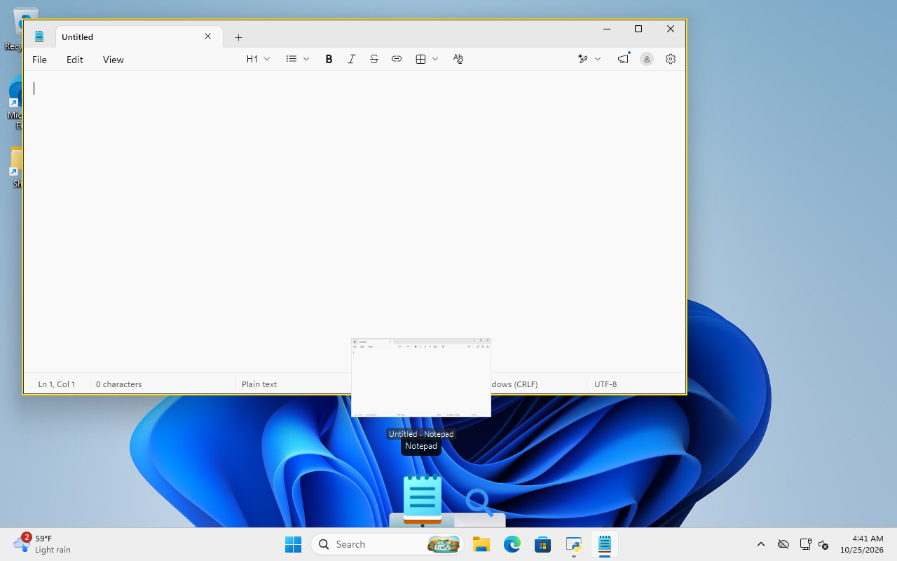

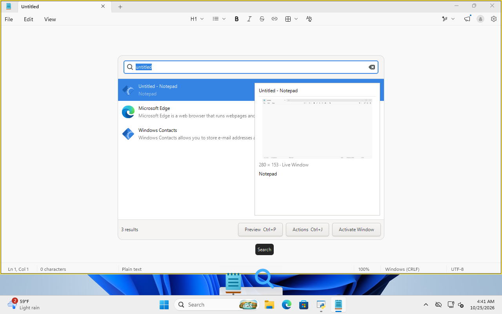

The preview/UI regression selection passed 126 tests under native Windows
Python, with 11 platform-specific cases skipped. All six visibility modes and
the existing Notepad launch/minimize/restore/Close desktop checks passed again
with preview capture and the input-alpha rendering enabled. The baseline
remains a single 1280×800 display at 96 DPI.

Windows draws its capture indicator around actively captured windows. Sessions
expire when no preview requests them. Indicator-free previews, a first capture
of an already minimized window, HDR/protected content, window outlines and
broader application coverage remain acceptance work. Multiple monitors and DPI
changes still require a real Windows display test.

```sh
python tools/windows_lab.py --share /path/to/shared/artifacts --timeout 150 run \
  'C:\msys64\ucrt64\bin\pythonw.exe' \
  '\\host.lan\Data\repo\tools\windows_capture_smoke.py' \
  --output '\\host.lan\Data\lab\capture'
python tools/windows_lab.py --share /path/to/shared/artifacts --timeout 240 run \
  'C:\msys64\ucrt64\bin\pythonw.exe' \
  '\\host.lan\Data\repo\tools\windows_preview_smoke.py' \
  --output '\\host.lan\Data\lab\previews'
```

API references: [window capture interop](https://learn.microsoft.com/en-us/windows/win32/api/windows.graphics.capture.interop/nf-windows-graphics-capture-interop-igraphicscaptureiteminterop-createforwindow),
[frame capture and resizing](https://learn.microsoft.com/en-us/windows/apps/develop/media-authoring-processing/screen-capture),
[Microsoft WinRT interface definitions](https://github.com/microsoft/windows-rs/blob/master/crates/libs/windows/src/Windows/Graphics/Capture/mod.rs),
[Direct3D11 SDK interfaces](https://github.com/microsoft/win32metadata/blob/main/generation/WinSDK/RecompiledIdlHeaders/um/d3d11.h).

## Files, folders and Search

Filesystem targets now recognize native drive paths before URL parsing treats
`C:` as a scheme. File URLs decode into native drive or UNC paths, retaining a
network server rather than opening a same-named local file. The shared decoder
also feeds file previews, image loading and drag/drop. POSIX authority and
filename-byte handling retain their existing behavior.

Search recognizes Windows drive, UNC, home and relative path syntax and routes
it to the Path provider. Copy Path returns a native filename with its drive or
server intact. Text previews normalize Windows line endings for display.

Gio's Win32 file-URL parser drops the authority from a standard UNC URL in the
lab runtime. The file adapter constructs Windows filesystem objects from their
decoded native paths. Metadata, folder browsing/monitoring and recorded icon
files use that boundary. Image thumbnails also convert Gio's Windows extension
content types (such as `.png`) to MIME types before selecting the image loader.
Default-handler opening uses the native Windows shell association; the lab's
Gio URI-launch path opened a blank Notepad instead of the requested document.
Ordinary Windows documents no longer trigger Unix executable-launcher creation.

`windows_file_smoke.py` creates isolated drive and SMB-share fixtures with
spaces, accents, `#`, `+` and `%` in their filenames. It checks canonical targets,
Search results and copy actions, real image thumbnails, directory enumeration
and text previews. Desktop stages open documents through their native default
handler, read back the actual Notepad text, open Explorer, inspect a pinned
folder stack and a Search preview, copy a path through Search, and drag a real
Explorer item onto the dock. The drop must persist in the dock configuration.
The tool records PNGs and closes only its own fixtures. Its desktop input
assumes the documented baseline, with no other dock, editor or Explorer window
open.

```sh
python tools/windows_lab.py --share /path/to/shared/artifacts --timeout 240 run \
  'C:\msys64\ucrt64\bin\pythonw.exe' \
  '\\host.lan\Data\repo\tools\windows_file_smoke.py' \
  --output '\\host.lan\Data\lab\files'
```

The `windows-file-geometry-verified` desktop run passed every stage and exited
normally. Independent native window observations and clipboard readback confirm
that both default-opened documents contained their expected text, and Search
copied the exact Unicode drive path. The Explorer drop persisted the canonical
file URI. The folder, Search and drop PNGs were visually inspected. Directory
metadata and previews also passed against the actual `host.lan` SMB share.
The file, folder, icon, menu and Search regression selection passed 286 tests
under native Windows Python, with 18 platform-specific cases skipped. Native
folder checks use the Windows hidden attribute as well as the visible-file
policy.

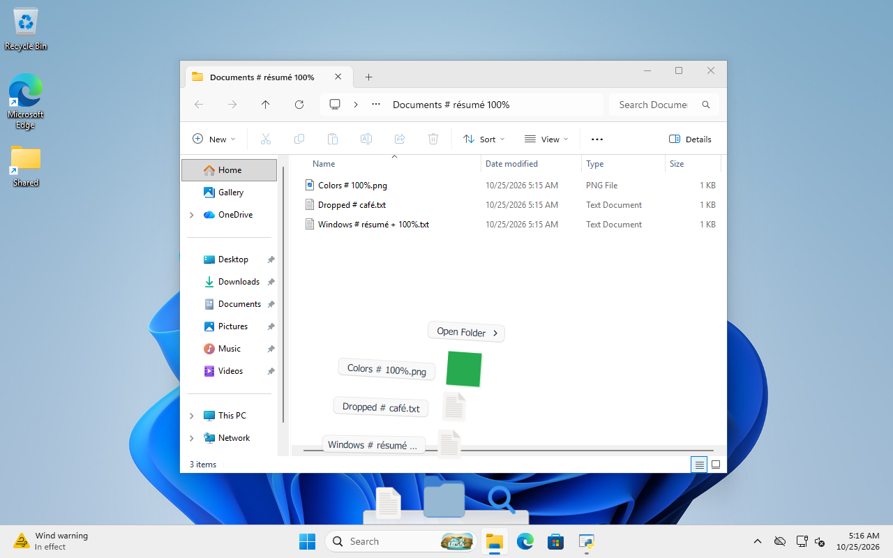

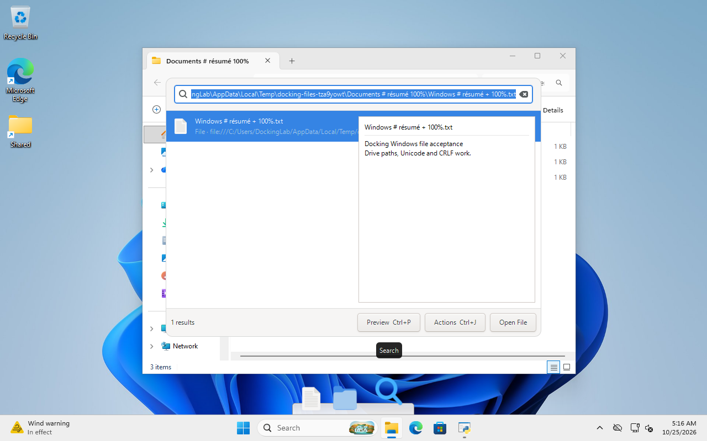

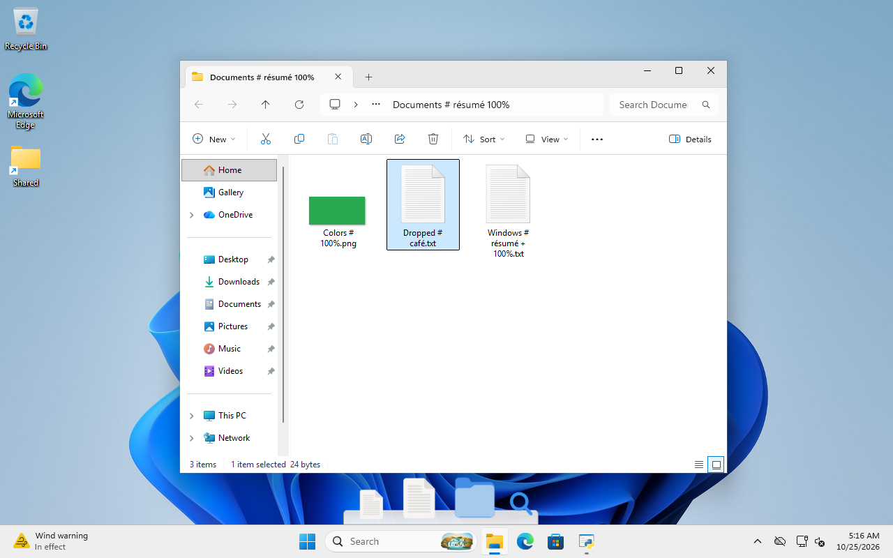

Native application identity/grouping for arbitrary dropped executables and
shortcuts remains separate acceptance work. Network disconnect/reconnect
behavior and broader folder-monitor scenarios
also remain pending.

References: [Python file-URL conversion](https://docs.python.org/3.14/library/urllib.request.html#urllib.request.url2pathname),
[Gio native file paths](https://docs.gtk.org/gio/type_func.File.new_for_path.html),
[Gio platform content types](https://docs.gtk.org/gio/content-types.html),
[Windows shell file associations](https://docs.python.org/3.14/library/os.html#os.startfile).

## Native Search shortcut

Windows uses `RegisterHotKey` for the configured Search shortcut, starting with
`Ctrl+Alt+Space`. A dedicated thread owns registration, native messages and
release. The thread posts activation and status callbacks to GTK; stopping or
replacing the service discards older generations and cancels their pending
callbacks. Repeated activation notifications are bounded while GTK is busy.
Windows' `MOD_NOREPEAT` flag suppresses held-key repeat.

The existing Preferences capture lifecycle suspends the registration before
capturing a new key, restores it on cancellation, and rebinds after a change.
A competing registration reports the existing **Conflict** status, with no
binding advertised. Disabling Search and normal Quit release the owned hotkey.
The Windows path does not attempt the XDG portal or X11 fallback.

Captured GDK key names map to native virtual keys or characters translated in
the foreground keyboard layout. F12 is reserved by Windows for debuggers and
is rejected. The XDG `NUM` modifier has no Win32 registration equivalent.
The desktop acceptance uses the lab's US keyboard layout; broader keyboard
layouts, dead keys, remote sessions and Windows-reserved combinations still
need acceptance.

`windows_shortcut_smoke.py` runs the complete application composition and GTK
main loop with isolated settings. Its driver sends native `SendInput` events
and independently observes HWNDs and foreground focus. GTK state observations
and Preferences actions are marshalled to the application's main loop.
The `windows-shortcuts-visual-verified` run verified activation from Notepad,
Search typing focus, toggle-to-hide and return to Notepad, held-key suppression,
and activation with Caps Lock and Num Lock toggled. It captured and persisted
`Ctrl+Alt+K`, released the previous binding, created a real competing registration
and showed Conflict in Preferences, recovered after that owner released the
key, completed five capture/cancel cycles with one worker, and passed disable/
reenable. After normal application shutdown an independent registration could
acquire both old and new combinations again. The Search and Preferences PNGs
were inspected. Sixty-one focused shortcut/controller checks also passed under
native Windows Python.

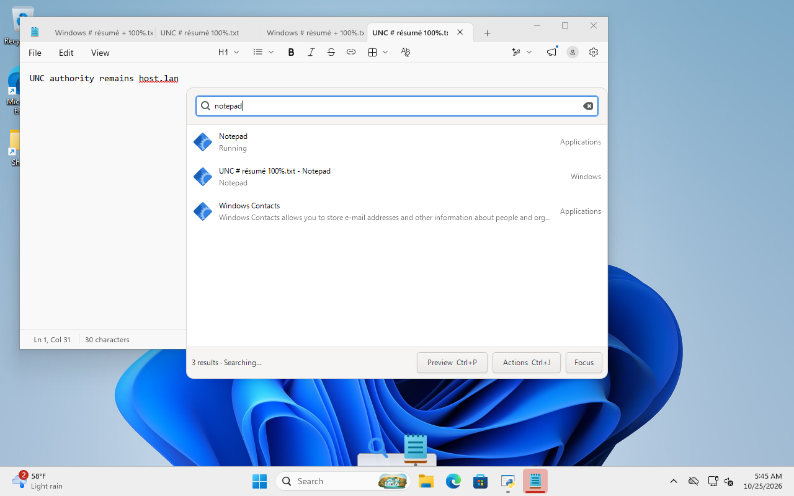

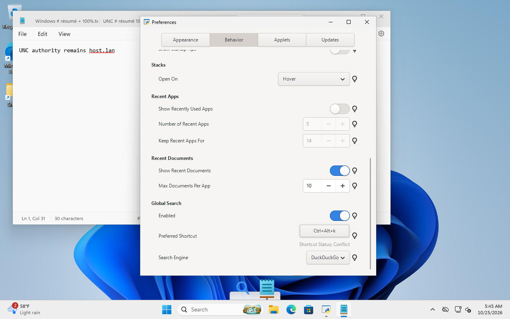

```sh
python tools/windows_lab.py --share /path/to/shared/artifacts --timeout 240 run \
  'C:\msys64\ucrt64\bin\pythonw.exe' \
  '\\host.lan\Data\repo\tools\windows_shortcut_smoke.py' \
  --output '\\host.lan\Data\lab\shortcuts'
```

References: [RegisterHotKey](https://learn.microsoft.com/en-us/windows/win32/api/winuser/nf-winuser-registerhotkey),
[native hotkey messages](https://learn.microsoft.com/en-us/windows/win32/inputdev/wm-hotkey),
[keyboard-layout translation](https://learn.microsoft.com/en-us/windows/win32/api/winuser/nf-winuser-vkkeyscanexw),
[UnregisterHotKey](https://learn.microsoft.com/en-us/windows/win32/api/winuser/nf-winuser-unregisterhotkey).

## Search artwork

Search resolves application and window icons through canonical application
metadata and the shared icon loader, including its background Windows shell
extraction. Pinned items borrow their current dock artwork, preserving painted
applets, custom icons and image aspect ratios. Providers continue to publish
immutable descriptors without GTK objects.

Native completion, model changes and applet presentation notifications update
the images of current visible rows. They do not rebuild rows, rerun providers,
change selection or disturb entry focus. Destroying Search unsubscribes all
three sources; late notifications cannot touch destroyed widgets. Canonical
icon file URIs use the existing platform path decoder, including Unicode and
escaped literal characters. Windows paths do not use Flatpak's host-root map.

`windows_search_icon_smoke.py` runs the full application with isolated settings.
It briefly holds one real shell extraction until Search displays its fallback,
then releases the extraction and verifies the published native pixels in the
same row. It checks the unchanged query, selection, row generation and typing
focus, launches Notepad with Enter, verifies artwork for its application and
live-window results, and compares the pinned Clock artwork with the dock's
painted icon. The `windows-search-icons-desktop` run passed all stages and
normal shutdown. The Notepad, live-window and Clock PNGs were inspected.
The focused Search/icon selection passed 87 native Windows tests, with two
platform-specific cases skipped.

```sh
python tools/windows_lab.py --share /path/to/shared/artifacts --timeout 240 run \
  'C:\msys64\ucrt64\bin\pythonw.exe' \
  '\\host.lan\Data\repo\tools\windows_search_icon_smoke.py' \
  --output '\\host.lan\Data\lab\search-icons'
```

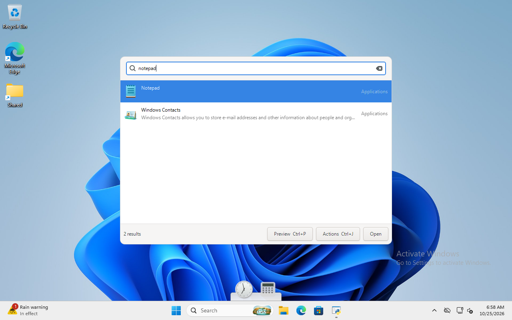

The baseline verifies activation from the focused desktop background and
Notepad. The Start-menu focus failure found during these checks is addressed
by the shell handoff integration below. Some internal system applications expose
flat shell tiles rather than useful artwork; their visibility and artwork belong
to the broader application-inventory acceptance.

## Search activation during shell handoff

Native tracing reproduced the startup failure: GTK had focused Search while
Windows still considered the Start menu foreground, and the shell then returned
foreground ownership to the taskbar. Search now observes that pending handoff
from verified Explorer/Start/Search processes and completes the original
activation on GTK's idle loop. The target must belong to Docking's process and
match the requested Search window. An unrelated application taking focus,
hiding/destroying Search, successful activation or a 750 ms expiry cancels the
request. Foreground changes after success remain under user control.

`windows_focus_smoke.py` runs the complete application and activates Search as
soon as the native shortcut reports Bound. It records foreground HWNDs, native
GUI-thread focus, GTK map/focus events and typing. Earlier Start, taskbar and
desktop runs injected input from Docking's own process and passed, including
outside-click focus, normal shutdown, work-area restoration and independent
hotkey reacquisition. The same instrumented Start-menu case failed before the
handoff integration and passed afterward.

A subsequent regular `run.py` launch exposed a remaining failure when a
separate process sent Start, Escape and the shortcut: Search mapped and had
GTK-thread focus, while Explorer retained native foreground ownership. QEMU's
virtual keyboard reproduced the failure. Same-process input can therefore
overstate foreground acceptance. The smoke tool now uses a separate injector
by default; `--same-process-input` retains the earlier diagnostic comparison.
Regular shell activation remains open, along with broader keyboard layouts,
remote sessions and display configurations. No manual click is counted as a
successful hotkey activation.

With the independent injector, the desktop and settled-taskbar cases pass
foreground ownership, typing, outside-click focus and normal-shutdown checks.
The immediate Start-close case fails. `--delay` controls the interval between
dismissing Start and pressing the shortcut, allowing that transition to be
investigated separately from normal desktop activation.

```sh
python tools/windows_lab.py --share /path/to/shared/artifacts --timeout 180 run \
  'C:\msys64\ucrt64\bin\pythonw.exe' \
  '\\host.lan\Data\repo\tools\windows_focus_smoke.py' \
  --output '\\host.lan\Data\lab\focus-start' --origin start
```

Use `--origin taskbar` and `--origin desktop` for the other startup cases.

References: [foreground activation](https://learn.microsoft.com/en-us/windows/win32/api/winuser/nf-winuser-setforegroundwindow),
[GUI-thread observations](https://learn.microsoft.com/en-us/windows/win32/api/winuser/nf-winuser-getguithreadinfo).

## AI Usage applet and headless hooks

AI Usage now imports and runs on native Windows. Its hook writers use a
path-derived Windows named mutex; POSIX keeps its existing `flock` contract.
This serializes concurrent writers without Windows byte-range locks blocking
ordinary preference readers. Reads and writes explicitly use UTF-8. Four real
concurrent hook subprocesses repeatedly replaced their own sessions and retained
every final session and unrelated Unicode preference.

Windows hook registration uses a headless Python runner with native arguments.
A dock launched by `pythonw.exe` selects the adjacent `python.exe` for hooks
that consume stdin. Claude's documented exec form uses `command` plus `args`;
Codex receives a native notify argv encoded as valid TOML, including backslashes,
spaces and bracket characters. Registration is idempotent and preserves
unrelated Claude hooks when replacing old Docking commands.

`windows_aiusage_smoke.py` runs the full application with AI Usage pinned and
isolated provider settings. The applet registers its real Windows commands;
the generated Claude hook imports a Unicode-path transcript fixture through
stdin while Docking runs, preserving foreground ownership. Its normal poll
method is then invoked without waiting for the 60-second interval. The check verifies 1,500 tokens,
repainted artwork, native wheel selection of Claude, tooltip and context menu,
and normal shutdown. The tooltip and menu PNGs were inspected. The combined
AI Usage, Search, focus and shortcut selection passed 208 native Windows tests
with one POSIX-only filename case skipped, and 209 tests on Linux. Live provider
CLI installations and real sessions remain broader integration acceptance.

```sh
python tools/windows_lab.py --share /path/to/shared/artifacts --timeout 180 run \
  'C:\msys64\ucrt64\bin\pythonw.exe' \
  '\\host.lan\Data\repo\tools\windows_aiusage_smoke.py' \
  --output '\\host.lan\Data\lab\aiusage'
```

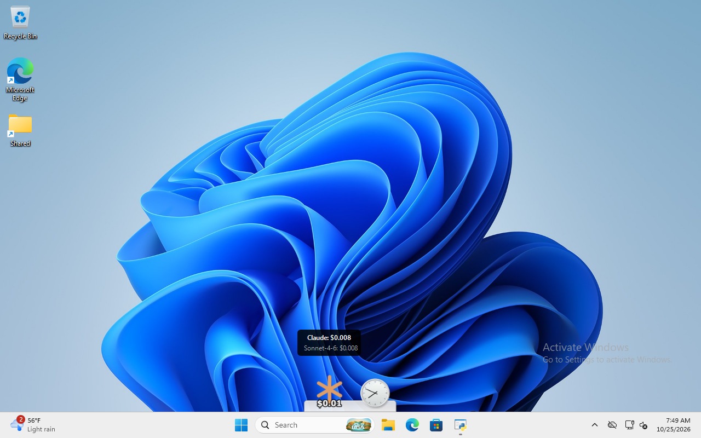

References: [Windows mutex ownership](https://learn.microsoft.com/en-us/windows/win32/api/synchapi/nf-synchapi-createmutexw),
[kernel object namespaces](https://learn.microsoft.com/en-us/windows/win32/termserv/kernel-object-namespaces),
[Claude command hook fields](https://code.claude.com/docs/en/hooks#command-hook-fields).

## Ambient playback and audio capture

The lab now installs GStreamer and its base, good and bad plugin packages,
including the native WASAPI output. `AUDIO=Y` exposes an emulated sound device
and the browser audio stream. Enable Audio under Settings → Advanced in the
web viewer to listen. The verified console-session baseline has one Windows
output device; physical devices, Bluetooth, RDP redirection and device changes
remain broader acceptance.

Ambient uses `Gst.filename_to_uri()` for sound files. On this Windows runtime,
`Path.as_uri()` produced a UNC URI that GStreamer's GIO source opened without
the server name. The GStreamer conversion preserves the share and reaches
PLAYING. A native URI-handler test also checks a UNC filename containing
Unicode, spaces, percent, hash and plus characters. Playback that fails its
initial state change now releases the pipeline and bus watch and stays stopped.

Native validation also found that White Noise selected GStreamer's sine mode.
The shared mapping now selects white noise; both noise modes are checked
against GStreamer's real named enum on Linux and Windows.

The first complete plugin-registry scan measured about 584 seconds on the VM;
a cached `Gst.init()` measured about 65 ms. Bootstrap prepares the full registry
during setup. The isolated desktop smoke copies this installed dependency
metadata into its own cache, while keeping app preferences and runtime files
separate. This verifies playback after setup; it does not measure cold scanning
as application startup.

`windows_ambient_smoke.py` runs the normal dock and uses native clicks, menu
navigation and wheel events. `windows_vm_audio.py` records the actual QEMU audio
relay as 48 kHz stereo PCM and WAV files. The successful run verified all seven
bundled OGG sounds through `wasapi2sink`, white and pink noise, volume changes,
muting, and stop. Muted output remained at the 16-bit quantization floor; after
stop the relay supplied no frames. A separate short OGG fixture under a Unicode
share path completed four real end-of-stream repeats while audio continued.
Normal shutdown restored the work area and released the hotkey. Playing and
menu captures were inspected. Ambient's focused suite passed 45 native Windows
tests and 44 Linux tests, with the Windows-only UNC case skipped on Linux.

Use a fresh output directory for each run. Start the guest job, then service its
audio requests from the host:

```sh
python tools/windows_lab.py --share /path/to/shared/artifacts --wait 1 start \
  'C:\msys64\ucrt64\bin\pythonw.exe' \
  '\\host.lan\Data\repo\tools\windows_ambient_smoke.py' \
  --output '\\host.lan\Data\lab\ambient-acceptance'
python tools/windows_vm_audio.py --share /path/to/shared/artifacts \
  --name ambient-acceptance --timeout 300
```


References: [GStreamer filename conversion](https://gstreamer.freedesktop.org/documentation/gstreamer/gsturihandler.html#gst_filename_to_uri),
[noise modes](https://gstreamer.freedesktop.org/documentation/audiotestsrc/index.html),
[native WASAPI output](https://gstreamer.freedesktop.org/documentation/wasapi2/wasapi2sink.html),
[Dockur audio](https://github.com/dockur/windows#how-do-i-enable-audio).

## Native master volume

The Volume applet uses the public Core Audio `IAudioEndpointVolume` interface
on Windows. It controls the default multimedia output device, including master
level and mute, and opens the native Sound page with `ms-settings:sound`.
The existing one-second background poll follows changes from other controls.
Each operation resolves the current default endpoint and releases its COM
interfaces on the calling thread. A missing device leaves polling available
for recovery instead of permanently disabling the backend.

`windows_volume_smoke.py` runs the complete dock with Ambient as a real audio
source. Native wheel input checks five-point changes and both limits; native
clicks toggle mute. With Explorer foreground, Windows' own volume and mute
keys change the endpoint and the applet follows through its ordinary poll.
The host audio capture verifies sound at 50% and 100%, silence at zero and
under both external and applet mute, and sound after unmuting. The endpoint's
scalar uses a driver-dependent audio curve, so the measurement checks a real
increase rather than assuming that 50% means half the amplitude.

The desktop check also enables Show Level through the menu, verifies its saved
preference, and opens the Windows Sound settings page from that menu. It
restores the original endpoint scalar and mute state, then quits the dock
normally and checks work-area restoration and hotkey release. Menu, tooltip,
level and Settings captures accompany the result. The focused suite passed
70 tests on native Windows and 69 on Linux, with the native apartment read
check skipped on Linux. Fault-injection tests cover missing/default-device
changes and cleanup after partial COM acquisition. Physical devices, role
differences, Bluetooth and RDP routing still need desktop acceptance.

```sh
python tools/windows_lab.py --share /path/to/shared/artifacts --wait 1 start \
  'C:\msys64\ucrt64\bin\pythonw.exe' \
  '\\host.lan\Data\repo\tools\windows_volume_smoke.py' \
  --output '\\host.lan\Data\lab\volume-acceptance'
python tools/windows_vm_audio.py --share /path/to/shared/artifacts \
  --name volume-acceptance --timeout 240
```

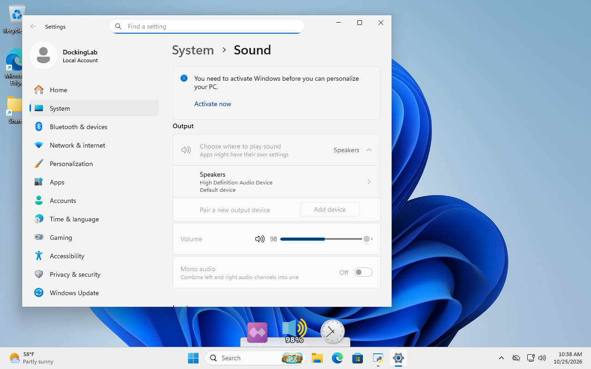

References: [default audio endpoint](https://learn.microsoft.com/en-us/windows/win32/api/mmdeviceapi/nf-mmdeviceapi-immdeviceenumerator-getdefaultaudioendpoint),
[master volume scalar](https://learn.microsoft.com/en-us/windows/win32/api/endpointvolume/nf-endpointvolume-iaudioendpointvolume-setmastervolumelevelscalar),
[endpoint mute](https://learn.microsoft.com/en-us/windows/win32/api/endpointvolume/nf-endpointvolume-iaudioendpointvolume-setmute),
[Windows Settings URIs](https://learn.microsoft.com/en-us/windows/apps/develop/launch/launch-settings).

## Native Battery and Power Settings

The Battery applet now selects a native Windows backend for its normal system
readings. `GetSystemPowerStatus` supplies the aggregate percentage, charge flag
and time remaining. `CallNtPowerInformation(SystemBatteryState)` supplies the
instantaneous rate, interpreted as a signed 32-bit value in milliwatts and
displayed as a magnitude in watts. The frequent power poll does not spawn a
subprocess. Only DLL bindings are cached; every poll reads current data.

AC power alone does not imply charging. A plugged-in battery can be idle,
and an unknown percentage remains distinct from zero and from no battery.
Unknown readings show a question mark and an unknown tooltip. Unknown time
and rate sentinels are omitted; the discharge-time estimate is not reused as
a time-to-full estimate. Power Settings opens `ms-settings:powersleep` through
the native shell association. Windows does not attempt UPower peripheral
discovery; native accessory battery discovery remains pending.

`windows_battery_smoke.py` runs the full dock and compares the native readings
with Windows Forms' power-status interface and `Win32_Battery` enumeration.
On the lab VM both report AC power with no system battery, and the applet shows
the disabled glyph and “No battery” tooltip. Native keyboard input changes
and persists the overlay preference and opens the actual System > Power page.
Normal shutdown restores the exact work area, releases the Search shortcut,
and removes both Battery timers.
Focused battery, hover, tooltip and interaction tests passed 215 cases on
native Windows and 214 on Linux, with the native API case skipped on Linux.

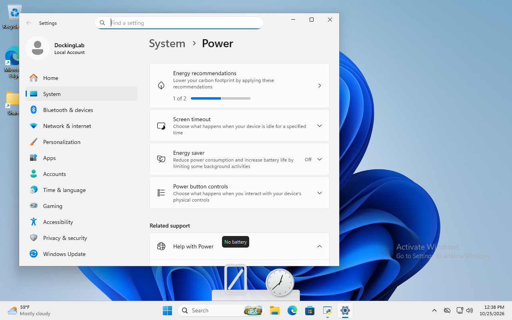

The optional `--exercise-fixtures` mode then injects clearly labeled PowerAPI
snapshots through the real backend and applet pipeline. Desktop captures check
discharge/remaining time, charging, plugged-in idle, watts and unknown readings.
These are rendering and control acceptance, not physical battery evidence.
Physical batteries, multiple batteries, UPS behavior, unplug/replug, resume and
wireless accessory charge readings still need hardware acceptance.


The captures exposed two shared UI regressions. The white charging bolt was
invisible above a low green fill; an outline now keeps it legible. Also, a
native enter event without a subsequent motion event left hover identity and
the tooltip unset. The enter handler now resolves hover immediately. Regression
tests failed before these fixes, including entry at all four dock edges, and
the final Windows desktop check confirms visible tooltips for every state.

The native desktop observer now excludes DWM-cloaked retained application
frames, so a suspended UWP Settings frame is not mistaken for a visible window.

```sh
python tools/windows_lab.py --share /path/to/shared/artifacts --wait 1 start \
  'C:\msys64\ucrt64\bin\pythonw.exe' \
  '\\host.lan\Data\repo\tools\windows_battery_smoke.py' \
  --output '\\host.lan\Data\lab\battery' --exercise-fixtures
```

References: [system power status](https://learn.microsoft.com/en-us/windows/win32/api/winbase/ns-winbase-system_power_status),
[native battery rate](https://learn.microsoft.com/en-us/windows/win32/api/winnt/ns-winnt-system_battery_state),
[power information query](https://learn.microsoft.com/en-us/windows/win32/api/powerbase/nf-powerbase-callntpowerinformation),
[Settings URI reference](https://learn.microsoft.com/en-us/windows/apps/develop/launch/launch-settings).

## Native Network monitoring, Wi-Fi and settings

The Windows Network backend reads transport-bound adapters and IPv4/IPv6
addresses with `GetAdaptersAddresses`, cumulative 64-bit byte counters with
`GetIfEntry2`, and default routes with `GetIpForwardTable2`. Route selection
adds the adapter metric to the route metric. Automatic selection prefers an
IPv4 default route, then an IPv6 default route, then a connected local link.
The returned route table is copied and released with `FreeMibTable`.

Counter reads use the current interface LUID so index reuse during an adapter
change cannot attach another device's counters to the old sample.
The interface preference stores the persistent adapter identifier, while the
menu and tooltip show its editable name. Explicit selection does not silently
switch to another adapter when the requested one disappears. A change of
identity resets the shared traffic baseline even when the display name stays
the same. IPv6 scope identifiers are retained for link-local addresses.
Automatic selection remains available as the “Auto” menu choice.

`windows_network_smoke.py` runs the complete dock and compares the selected
adapter's GUID, name, operational status and address with `Get-NetAdapter` and
`Get-NetIPAddress`. It brackets the native counters with
`Get-NetAdapterStatistics`, copies an owned 8 MiB payload over the lab SMB share,
and verifies that both byte totals increase by at least the payload size.
The applet's normal two-second poll produces visible speed updates; the test
uses native keyboard input to select an adapter, change the upload overlay,
hide speeds, and restore Auto, checking the persisted JSON preferences.

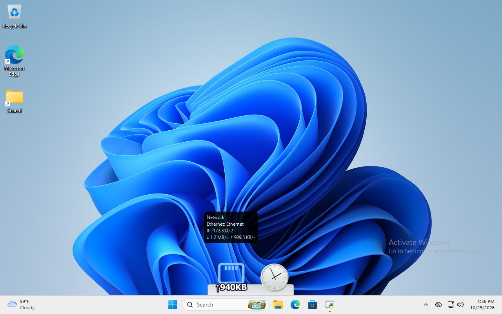

The same test opens the actual Network & internet and Advanced network settings
pages through backend-owned shell actions. Normal dock shutdown restores the
original work area, releases the Search shortcut and removes the Network timer.
The payload files are removed, and the desktop captures were inspected.

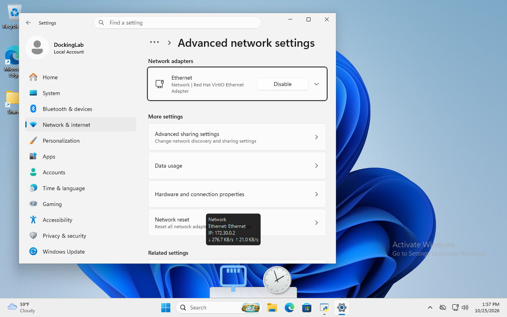

The initial monitoring milestone passed 269 focused cases on Linux, with six native-only cases skipped,
and 137 selected cases on Windows. The window backend layout change also passed
the real Notepad launch/minimize/restore/Close check without forced shutdown.

For the desktop tool, prepare `traffic-source.bin` containing 8 MiB of data in a
fresh output directory writable by the lab guest, then submit:

```sh
python tools/windows_lab.py --share /path/to/shared/artifacts --wait 1 start \
  'C:\msys64\ucrt64\bin\pythonw.exe' \
  '\\host.lan\Data\repo\tools\windows_network_smoke.py' \
  --output '\\host.lan\Data\lab\network'
```

The Windows connection manager implements the shared `ConnectionManager`
contract in `windows_connections.py`. `windows_wifi.py` owns WLAN bindings and
network/radio values; `windows_profiles.py` owns WinRT connection metadata.
Routine polls read `GetConnectedSsid` and `GetSignalBars` through WinRT and match
profiles to the selected adapter GUID. Signal bars map to 20-percent steps;
missing signal data stays unknown and has a question-mark glyph. A Wi-Fi link
with no accessible SSID is not labeled as Ethernet.

Discovery runs only when the user opens the Network menu, with scans throttled
to fifteen seconds. Location-sensitive WLAN current-connection and BSSID queries
are not used for routine monitoring. A denied discovery request appears as
“Permission denied” rather than an empty scan. Available networks retain the
exact adapter, raw SSID, case-sensitive profile and BSS type; a connection action
revalidates that identity before calling `WlanConnect`. Networks without a saved
profile open Windows Wi-Fi Settings for native credential setup. The menu also
opens native Wi-Fi/hidden-network and Mobile hotspot settings. Unusable networks
are disabled; software radio state is refreshed after writes and hardware-blocked
radios cannot be toggled. Shared capabilities omit the unsupported global
network switch. Native RAS/VPN control is described below.

The native no-adapter probe covered stopped and running WLAN service states,
then restored the original stopped state. Native enumeration agreed with an
independent `Get-NetAdapter` query. Forty repeated WLAN/WinRT reads kept the
process handle count at 159. Tests cover allocation and handle cleanup, partial
COM/HSTRING acquisition, existing STA and concurrent MTA calls, Unicode names,
raw SSID identity, stale menu entries, access denial and recovery.

Add `--exercise-wifi-fixtures` to the desktop command above to exercise labeled
Wi-Fi API snapshots through the complete application. Real keyboard/mouse input
selects a saved-profile fixture, turns its software radio off/on, verifies a
hardware-blocked toggle, unknown signal and permission-denied recovery, and
launches the actual Windows Settings application. On this no-Wi-Fi VM, the
wireless links redirected to Settings Home; the Wi-Fi and Mobile hotspot pages
remain unverified. The same run verifies real wired metadata and SMB traffic
before injection and restores the real backend before shutdown. The wireless snapshots do **not** prove physical Wi-Fi
association, authentication, signal accuracy, hardware switching or hotplug.

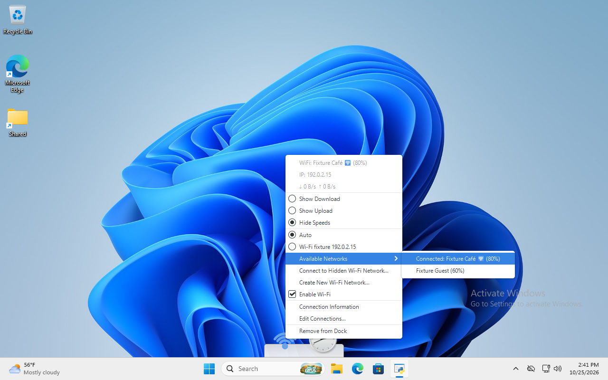

The baseline has one wired adapter on one display at 96 DPI. Physical Wi-Fi and
other adapter changes, multiple-route desktop acceptance, global networking
control and broader network hardware remain required parity work. VPN methods
beyond the verified IKEv2/password configuration also need acceptance.

References: [adapter addresses and interface metrics](https://learn.microsoft.com/en-us/windows/win32/api/iptypes/ns-iptypes-ip_adapter_addresses_lh),
[interface byte counters](https://learn.microsoft.com/en-us/windows/win32/api/netioapi/ns-netioapi-mib_if_row2),
[route metrics](https://learn.microsoft.com/en-us/windows-hardware/drivers/network/mib-ipforward-row2),
[route table ownership](https://learn.microsoft.com/en-us/windows-hardware/drivers/network/getipforwardtable2),
[Wi-Fi location-access changes](https://learn.microsoft.com/en-us/windows/win32/nativewifi/wi-fi-access-location-changes),
[connected SSID](https://learn.microsoft.com/en-us/uwp/api/windows.networking.connectivity.wlanconnectionprofiledetails.getconnectedssid),
[signal bars](https://learn.microsoft.com/en-us/uwp/api/windows.networking.connectivity.connectionprofile.getsignalbars),
[WLAN connection parameters](https://learn.microsoft.com/en-us/windows/win32/api/wlanapi/ns-wlanapi-wlan_connection_parameters),
[WLAN radio state](https://learn.microsoft.com/en-us/windows/win32/api/wlanapi/ns-wlanapi-wlan_phy_radio_state),
[WinRT ABI declarations](https://github.com/microsoft/windows-rs/blob/master/crates/libs/windows/src/Windows/Networking/Connectivity/mod.rs),
[Settings URI reference](https://learn.microsoft.com/en-us/windows/apps/develop/launch/launch-settings).

## Native Windows VPN connections

The Windows connection manager lists native VPN entries from both the current
user and all-user phonebooks using `RasEnumEntriesW` and `RasGetEntryPropertiesW`.
Entries are identified by GUID and normalized phonebook path; names can change
without retargeting an old menu item. Non-VPN entries and inaccessible/deleted
profiles are omitted. Connection state comes from `RasEnumConnectionsW` and
`RasGetConnectStatusW`, rather than the existence of a dialer window. The shared
VPN submenu now checks connected entries and disables pending or non-owned
actions; the phonebook path is available as a tooltip when scope matters.

Connecting opens Windows' `rasphone.exe` for the exact phonebook and current
entry name. Its absolute path comes from `GetSystemDirectoryW`, arguments are
quoted without a shell, and Windows owns credential prompts, cancellation and
errors. The dock does not read or save credentials. Disconnect runs off the GTK
thread, revalidates session identity and ownership, calls `RasHangUpW`, then
waits for the connection handle to disappear. Both invalid-handle and not-found
responses are expected during teardown. Duplicate disconnects are suppressed,
and shutdown waits for the bounded native teardown before discarding callbacks.
Existing OS-owned connections and dialer windows remain independent of the dock.

The acceptance endpoint used strongSwan 5.9.8 in a temporary container on the
private VM bridge, with a temporary trusted test CA and EAP-MSCHAPv2 credentials.
The profile used split tunneling and one route to an owned HTTP test address;
normal traffic did not use the test VPN. Native user/system profile dialogs
were opened and cancelled with keyboard input. The real connection was then
established from the dock, checked against PowerShell's VPN GUID/status, and
used to exchange an expected HTTP token through the tunnel. The menu's connected
checkmark and dock disconnect were verified. A second real connection exercised
an external Windows disconnect and the resulting menu state.

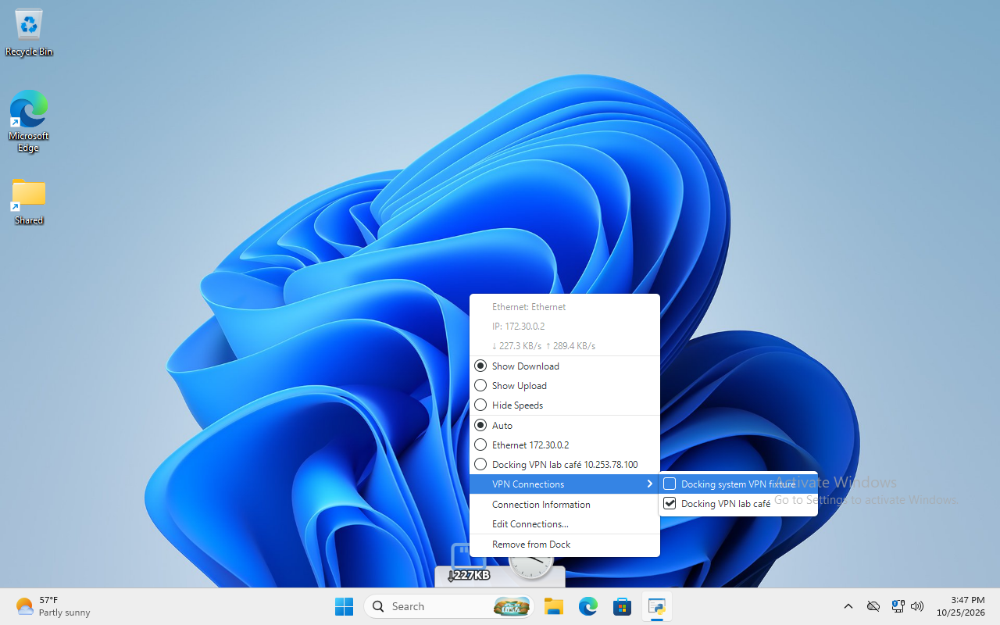

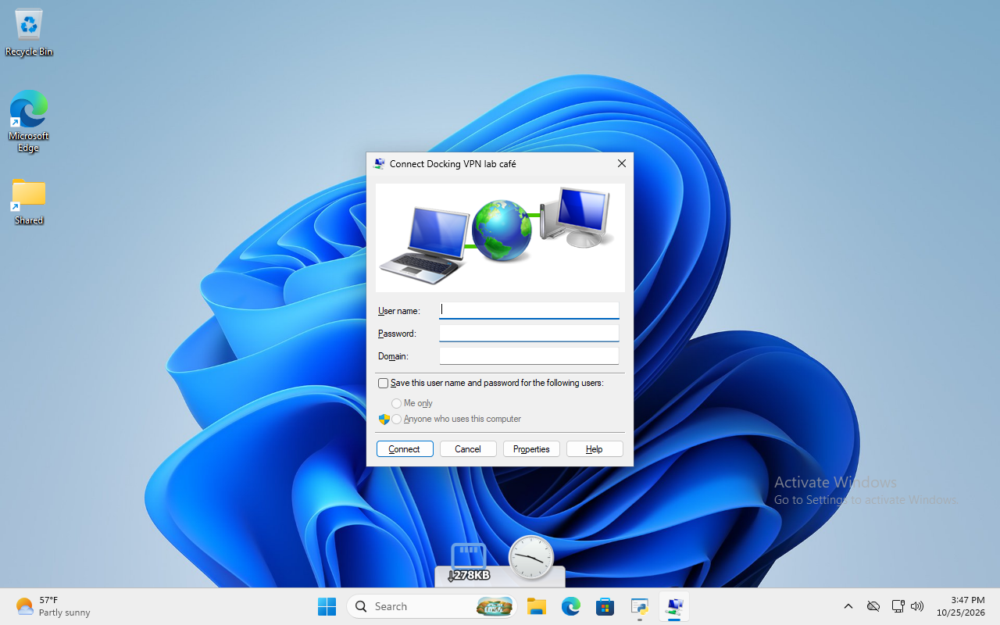

`windows_vpn_smoke.py` requires an owned fixture JSON file containing `address`,
`port`, expected HTTP `token`, and the IKEv2 `username`/`password`. A sibling
`profiles.json` lists the two provisioned user/system VPN profiles by GUID and
phonebook. The tool checks their ownership markers, uses actual input for menu
and credential actions, omits credentials from reports, and restores the work
area, timer and Search hotkey through normal shutdown. Profile/certificate and
endpoint provisioning/cleanup are separate lab steps. The test CA, both owned
profiles, endpoint container and generated credentials must be removed after
acceptance. Other authentication methods, server policies, vendor clients,
resume, reconnect and multi-user sessions remain broader acceptance work.

```sh
python tools/windows_lab.py --share /path/to/shared/artifacts --wait 1 start \
  'C:\msys64\ucrt64\bin\pythonw.exe' \
  '\\host.lan\Data\repo\tools\windows_vpn_smoke.py' \
  --fixture '\\host.lan\Data\lab\vpn-endpoint\fixture.json' \
  --output '\\host.lan\Data\lab\vpn-acceptance'
```

References: [RAS enumeration](https://learn.microsoft.com/en-us/windows/win32/api/ras/nf-ras-rasenumentriesw),
[entry properties](https://learn.microsoft.com/en-us/windows/win32/api/ras/nf-ras-rasgetentrypropertiesw),
[connection status](https://learn.microsoft.com/en-us/windows/win32/api/ras/nf-ras-rasgetconnectstatusw),
[disconnect and teardown](https://learn.microsoft.com/en-us/windows/win32/api/ras/nf-ras-rashangupw),
[SDK ABI definitions](https://github.com/microsoft/win32metadata/blob/main/generation/WinSDK/RecompiledIdlHeaders/um/Ras.h),
[strongSwan Windows interoperability](https://docs.strongswan.org/docs/latest/interop/windowsClients.html).

## Native Session actions

Session uses a semantic `SessionBackend` contract: list available actions,
request an action, and stop applet-owned work. The shared state contains labels,
and the GTK applet handles icons, menu ordering and disabled actions. Linux and
BSD implement the contract through their existing session commands; Unix lock
fallbacks, D-Bus calls and Flatpak host execution live in `session/unix.py`.
Windows does not construct Unix commands.

`session/windows.py` uses `LockWorkStation` for lock, `ExitWindowsEx` for sign
out/restart/power off, and `SetSuspendState` for suspend. Power actions require
an existing `SeShutdownPrivilege` in the process token. Menu probes only read
the token; requests enable that right temporarily and restore its exact prior
state before closing the token handle. No rights are added or elevation
requested. Power capability reads use the SDK's 76-byte
`SYSTEM_POWER_CAPABILITIES`; Suspend requires an actual S1/S2/S3 or S0 low-power
idle capability, and power off requires S5. Availability is rechecked when an
action executes. Requests run on one owned worker to keep the GTK loop responsive
and suppress duplicates. Shutdown does not force applications closed; Windows
owns unsaved-work prompts and may reject or cancel a transition. An accepted
request is distinct from an observed completed transition.

On the baseline VM, native capabilities and independent `powercfg /a` agree that
no sleep state is available, so Suspend is disabled. Real left-click lock was
verified with WTS session flags changing from unlocked to locked, an independent
QEMU capture of the secure lock desktop, and external credential input to
unlock. The logon identity was unchanged after unlock, and normal dock shutdown
restored the work area and released the global shortcut.

Sign out, restart and power off were selected through the actual dock menu.
After sign out, WTS reported a new session/logon identity with the same boot
time, and Winlogon recorded the sign-out/sign-in events. Restart produced a new
boot time and a User32 planned-restart event from `pythonw.exe`. Power off
cleanly stopped the VM container; after starting that same persistent VM,
Windows reported another new boot and a User32 planned-power-off event from
`pythonw.exe`. Automatic login and the interactive lab agent recovered after
both boots. These transitions end the dock process and were verified externally;
they are distinct from the inspection/lock runs' normal GTK shutdown checks.

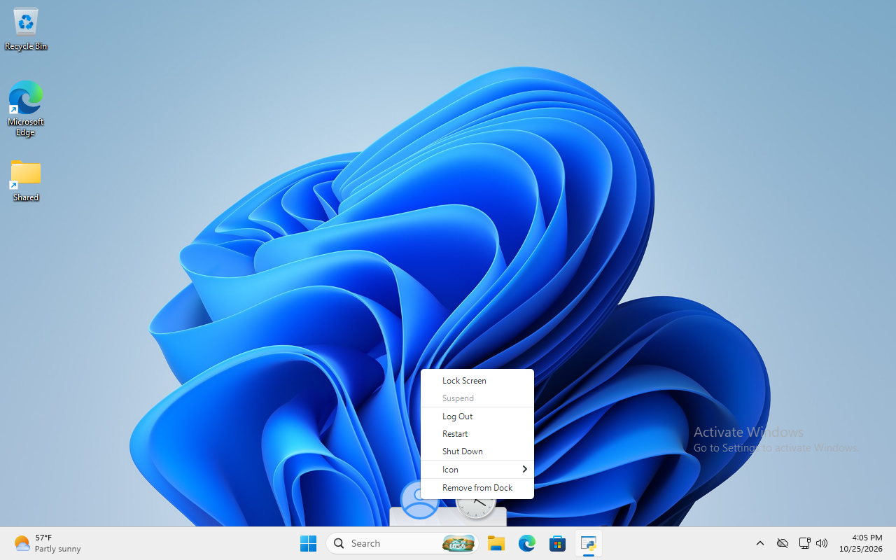

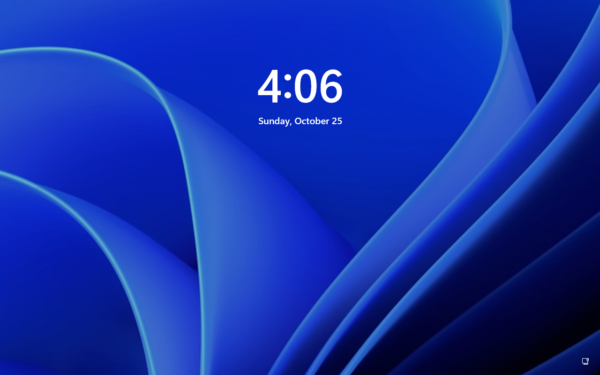

`tools/windows_session_smoke.py` uses real mouse/keyboard input and independent
WTS state. Its default mode inspects the menu and quits normally. `--action lock`
waits for an external unlock. `--action logout`, `reboot` or `poweroff` terminates
the guest session; a host observer must prove the transition and recover the
owned VM. The tool's pre-transition record alone is not proof of success.
Physical sleep/resume, Modern Standby, remote/multi-user sessions and domain
policies need broader acceptance.

References: [lock request semantics](https://learn.microsoft.com/en-us/windows/win32/api/winuser/nf-winuser-lockworkstation),
[graceful exit and shutdown rights](https://learn.microsoft.com/en-us/windows/win32/api/winuser/nf-winuser-exitwindowsex),
[suspend and wake events](https://learn.microsoft.com/en-us/windows/win32/api/powrprof/nf-powrprof-setsuspendstate),
[power capabilities](https://learn.microsoft.com/en-us/windows/win32/api/powerbase/nf-powerbase-getpwrcapabilities),
[token privilege changes and restoration](https://learn.microsoft.com/en-us/windows/win32/api/securitybaseapi/nf-securitybaseapi-adjusttokenprivileges),
[WTS lock state](https://learn.microsoft.com/en-us/windows/win32/api/wtsapi32/ns-wtsapi32-wtsinfoex_level1_w).

## Windows Mic Shield

Mic Shield follows one `MicShieldBackend` contract for state, explicit mute,
toggle, settings and shutdown. Shared state, tooltip/icon rendering, GTK menus
and lifecycle contain no audio-server commands or native API calls. Linux owns
PulseAudio/PipeWire source enumeration, monitor-source filtering, corked capture
streams, locale-stable `pactl` parsing and commands in `micshield/linux.py`.
Windows selects `micshield/windows.py` with Core Audio in `windows_audio.py`.

Windows enumerates every active **capture** endpoint rather than selecting only
the default microphone. The aggregate is muted only when all readable inputs
are muted. A known unmuted input disproves aggregate mute; otherwise unreadable
mute state stays unknown. Active session enumeration supplies capture process
IDs and names. Metadata failures retain known active capture; unreadable session
state stays unknown instead of becoming idle. A multi-process session is not
attributed to one PID. Interfaces, endpoint/session strings and process handles
are scoped to their acquisition thread. Capture queries use an MTA worker.

Native mute/unmute applies to all current input endpoints, continues protecting
other inputs after one fails and requires actual readback for success. An
unknown-state toggle chooses mute. Periodic reads are guarded, user transitions
are serialized and readback determines presentation. Construction performs no
provider query on GTK. Old polls cannot undo a completed action, and shutdown or
restart invalidates queued work, replies and the activity pulse. The applet's
Microphone Settings action opens **Privacy & security > Microphone**.

Native acceptance uses two emulated HDA inputs fed a generated 440 Hz tone
through an isolated ALSA file source. It opens neither a host microphone nor
physical audio hardware. Two separate Windows WASAPI recorder processes report
real PCM statistics; an independent C#/.NET Core Audio oracle reads and changes
endpoint mute and identifies the default input. Real mouse/menu input muted
both streams (RMS about 5,800 to below 1), restored both on unmute, and detected
an external change that left only the **non-default input unmuted**. Each
recorder's actual PID appeared in the menu. Stopping capture returned to idle
and stopped the red pulse. Native privacy Settings, accessibility metadata,
inspected screenshots, original mute restoration and normal close passed.
Unknown metadata uses an explicitly injected API fixture.

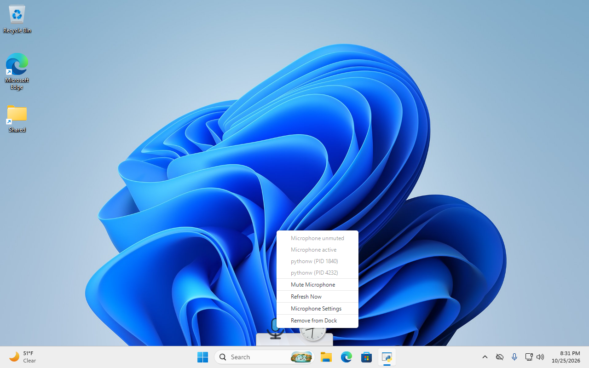

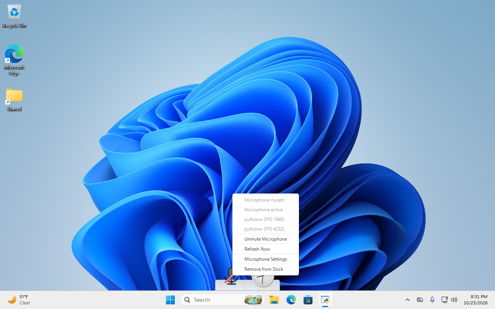

The optional fixture is separate from the normal lab. Generate its input, then
recreate only the owned lab with the microphone overlay:

```sh
python tools/windows_microphone_fixture.py --share /path/to/shared/artifacts
docker compose --env-file /path/to/lab.env -p lab \
  -f packaging/windows/lab/compose.yaml \
  -f packaging/windows/lab/compose.microphone.yaml up -d --force-recreate --pull never
python tools/windows_lab.py --share /path/to/shared/artifacts configure-share
```

Record the two newly created capture endpoint IDs and original mute state. Run
`tools/windows_micshield_smoke.py --output ... --device ID1 --device ID2` in the
interactive Windows lab. It restores mute state and closes its owned recorders.
After acceptance, recreate the lab with **only** `compose.yaml`, reconnect its
share, verify the capture endpoints are gone, and remove the generated
`lab/microphone-fixture/tone.raw` and `alsa.conf`. The verifier's
`--expect-absent` mode checks the regular lab's real no-input UI and Settings.
Keep screenshots and result journals. The regular demo's pins and recent
history remain separate from all acceptance configurations.

This controls capture endpoint mute. Hardware-supported controls also affect
exclusive streams; software controls can be bypassed by exclusive access.
Physical/USB/Bluetooth/RDP inputs, hotplug/default changes during capture,
exclusive-mode behavior, protected or multi-process sessions and broader
permission/policy cases remain acceptance work.

References: [capture endpoint enumeration](https://learn.microsoft.com/en-us/windows/win32/api/mmdeviceapi/nf-mmdeviceapi-immdeviceenumerator-enumaudioendpoints),
[endpoint mute and shared/exclusive behavior](https://learn.microsoft.com/en-us/windows/win32/api/endpointvolume/nn-endpointvolume-iaudioendpointvolume),
[active session state](https://learn.microsoft.com/en-us/windows/win32/api/audiopolicy/nf-audiopolicy-iaudiosessioncontrol-getstate),
[process attribution](https://learn.microsoft.com/en-us/windows/win32/api/audiopolicy/nf-audiopolicy-iaudiosessioncontrol2-getprocessid),
[synthetic ALSA file input](https://www.alsa-project.org/alsa-doc/alsa-lib/pcm_plugins.html).

## Windows Cam Shield

Cam Shield uses one `CamshieldBackend` for state, lock/unlock capabilities,
explicit actions, settings and shutdown. Shared GTK, rendering and state have
no `/dev`, procfs, ACL, `pkexec` or Windows API operations. Linux and BSD own
their camera discovery and privileged policies. Their shared Unix client
launches the existing permission helper only after a user action.

Windows selects `camshield/windows.py`. It aggregates Media Foundation capture
source metadata and sensor activity reports, grouping multiple devices held
by one PID. A reported process still counts as a holder when it is not currently
streaming, consistent with an open Linux video file descriptor. Process names
use the Windows process backend, retaining the PID when its executable cannot
be read. An uninitialized or failed monitor, or a missing device in a nonempty
report, produces **Camera activity unknown**. A successfully delivered empty
aggregate is the native idle notification, including after the last client
stops. Enumeration failure produces **Camera state unavailable**.
Reports for cameras no longer in the current inventory cannot keep them active.
The backend never activates a capture source or requests video frames.

Native callbacks live in an owned sensor process. That process owns its MTA,
Media Foundation lifetime, callback thunks, report interfaces and allocated
strings. The dock serializes small requests, validates replies and applies a
four-second request deadline. Failure reaps the owned process before replacing
it. Shutdown runs a bounded process reaper without blocking GTK. Construction
does no native work; guarded background queries, action serialization and
lifecycle generations reject stale reads and queued operations after stop or
restart. The activity pulse stops when activity ends or the applet stops.

Windows controls use the documented machine `AllowCamera` policy on Pro,
Enterprise, Education and IoT Enterprise. `windows_control.py` separates policy
state and explicit action dispatch from activity reporting. Policy and recovery
registry operations live in Windows implementations. The shared applet only
asks its backend for capabilities and actions.

Lock blocks **new sessions** across the machine. Already-open readers can keep
receiving frames; their activity and PIDs remain visible alongside **Camera
locked**. No camera is opened by the applet to test enforcement. The current
inventory covers available Media Foundation video sources, not every disabled
PnP device or proprietary camera stack. PnP disabling is deliberately not used:
the lab's generated software camera kept delivering real frames to a new reader
with a cached symbolic link even after its node reported disabled.

An explicit action launches the fixed `windows_helper.py lock|unlock` command,
using `ShellExecuteExW` with `runas` when the dock is not elevated. Cancellation,
helper failure, timeouts and failed readback do not report successful actions.
An elevated dock still uses a separate bounded helper. Background polling never
requests elevation. The helper serializes changes with a named mutex and writes
and flushes the original policy value before restricting access. Recovery data
lives in a fixed HKLM key with a protected administrator/SYSTEM writable DACL
and read-only access for users; every read verifies the key's owner and DACL.
The helper accepts no device ID, registry path or recovery-file arguments.

Unlock restores the original DWORD `1` or removes only the value when it was
previously absent. A restriction already set by another tool is never adopted.
If an administrator has replaced or removed Docking's restriction, recovery
preserves their current value and clears the stale record. Recovery survives
dock/backend restart and remains available with no cameras present. The camera
device enablement and per-app privacy permissions are independent of this
policy. Home and unrecognized editions keep monitoring and Settings without
advertising this policy control.

On the Windows 11 lab, two independent monitor start/stop cycles and repeated
queries returned an empty camera inventory, agreeing with a separate PnP camera
enumeration. The native desktop verifier checks this real absence state, both
unavailable controls, the Camera Settings menu handoff, accessibility metadata,
inspected screenshots, sensor-process exit and normal dock shutdown/work-area
restoration. Unknown and provider-error rendering also use explicitly injected
API fixtures.

Native capture acceptance uses a generated-frame Windows virtual camera. Two
independent Media Foundation reader processes receive real 320x240 NV12 frames
with advancing timestamps and changing pixel checksums. Shared mode permits
both clients to stream simultaneously; both actual PIDs appear in Cam Shield.
The activity pulse advances while they capture. Closing one reader keeps the
other active; closing the last reader yields the native empty report, returns
the menu to idle and stops the pulse. Reader and sensor-process exit, privacy
Settings, normal dock close and work-area restoration are verified. The test
opens no physical camera and uses no injected activity data.

Native policy acceptance uses the real GTK menu and elevated helper: a fresh
reader fails with `0x80070005` and zero frames while an existing reader keeps
capturing. A new backend recovers the saved policy and offers Unlock; after
Unlock, a fresh reader receives generated frames again. The exact policy
baseline and empty recovery journal are checked in final cleanup, alongside
all reader/sensor exits and normal dock shutdown.

**Physical/IR/proprietary devices and device hotplug/removal during capture
remain open.** Native `ShellExecuteExW`/`runas` dispatch and recovery with no
cameras present also passed. The lab has UAC disabled (`EnableLUA=0`), so actual
consent and cancellation on a standard-user desktop remain unverified;
cancellation and process-handle cleanup have focused API tests.

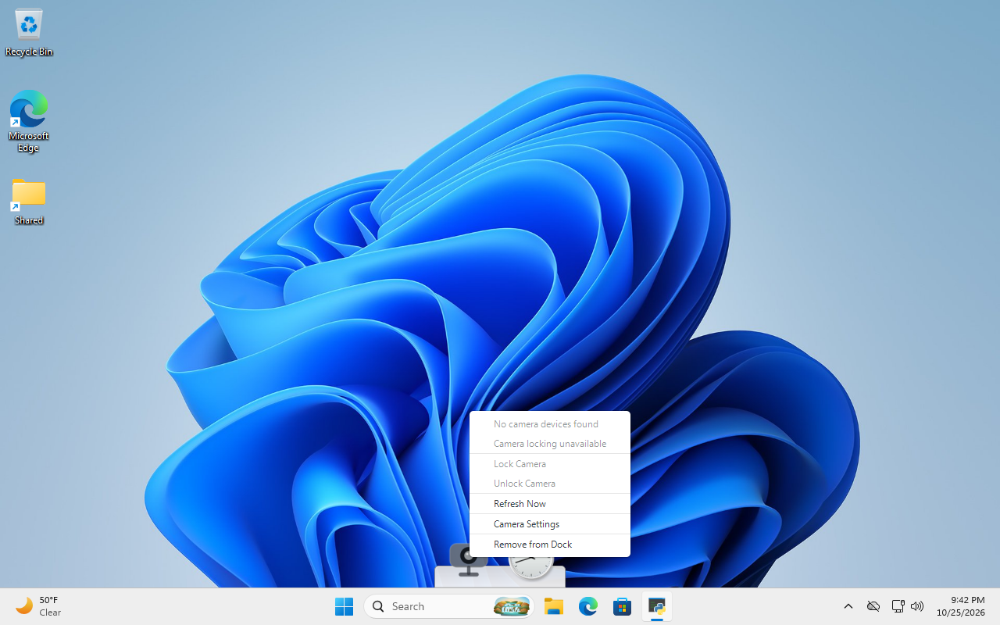

The following active state is an **API rendering fixture**, not native capture:

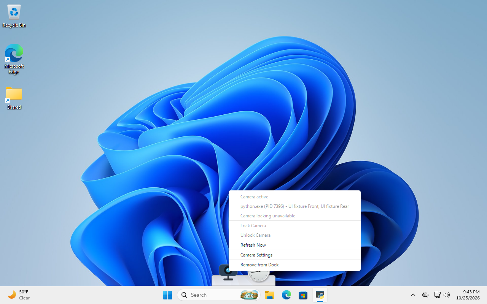

The following captures show **actual native capture clients** using only
generated frames:

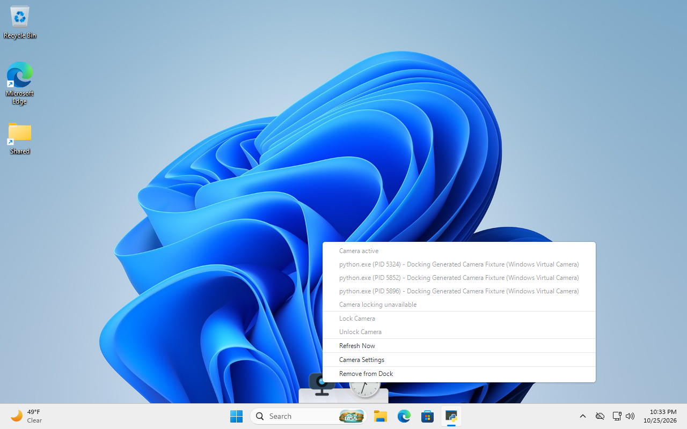


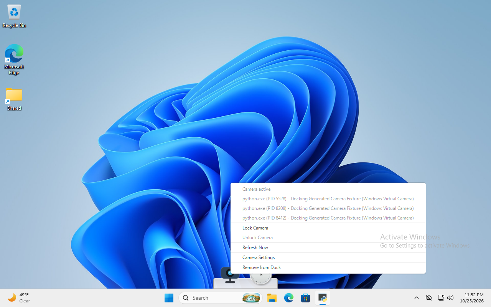

Run `tools/windows_camshield_smoke.py --output ... --expect-absent` in the
interactive owned Windows lab after preparing its GStreamer registry. Keep
the regular dock closed during acceptance and restore its normal configuration
afterward. The verifier uses an isolated configuration and leaves pin/recent
history intact.

For capture acceptance, use an elevated Windows 11 24H2-or-newer lab without
existing cameras, MSYS2 UCRT64 GCC (`mingw-w64-ucrt-x86_64-gcc`), Python/GTK and
Pillow. Run `tools/windows_camera_fixture.py --output C:\DockingLab\camera-test
--journal PATH\session.json --seconds 300` with a fresh local output directory
and journal directory. It compiles `windows_camera_source.cpp` with warnings as
errors and records ownership before registering its unique COM class. The
camera is current-user/session scoped and generates frames entirely in memory.
Before declaring readiness, a short native read/stop cycle verifies the frames
and releases Windows' initial registration activity, establishing an idle
baseline for the desktop verifier.
Use the exact symbolic link from the ready journal with
`tools/windows_camshield_smoke.py --output ... --device SYMBOLIC_LINK`.
Add `--verify-policy` to exercise actual menu Lock/Unlock, denied fresh capture,
continued existing capture, backend restart/recovery and restored capture. This
option requires the sole generated camera, a supported edition and an initially
unrestricted policy with no recovery pending. Its finalizer restores the saved
policy through the same helper even after a test failure. The verifier owns
and normally stops its capture processes. Write `stop` in
the fixture journal's directory to remove the camera and its owned COM class.
After an owner crash, `tools/windows_camera_fixture.py --recover PATH\session.json`
checks process identity, DLL hash and registry ownership before cleanup. Both
normal removal and recovery after terminating only the owned fixture process
have passed in the lab. Keep the result journals and screenshots; fixture COM
registration recovery is separate from applet camera policy recovery.

References: [sensor activity monitoring](https://learn.microsoft.com/en-us/windows/win32/api/mfidl/nf-mfidl-mfcreatesensoractivitymonitor),
[activity report callbacks](https://learn.microsoft.com/en-us/windows/win32/api/mfidl/nf-mfidl-imfsensoractivitiesreportcallback-onactivitiesreport),
[sensor process reports](https://learn.microsoft.com/en-us/windows/win32/api/mfidl/nn-mfidl-imfsensorprocessactivity),
[camera source enumeration](https://learn.microsoft.com/en-us/windows/win32/api/mfidl/nf-mfidl-mfenumdevicesources),
[camera privacy guidelines](https://learn.microsoft.com/en-us/windows/apps/develop/camera/camera-privacy-guidelines),
[session-scoped virtual cameras](https://learn.microsoft.com/en-us/windows/win32/api/mfvirtualcamera/nf-mfvirtualcamera-mfcreatevirtualcamera),
[custom media source requirements](https://learn.microsoft.com/en-us/windows-hardware/drivers/stream/frame-server-custom-media-source),
[shared camera sources](https://learn.microsoft.com/en-us/windows/win32/medfound/mf-devsource-attribute-frameserver-share-mode),
[machine camera policy and supported editions](https://learn.microsoft.com/en-us/windows/client-management/mdm/policy-csp-camera).

## Windows System Tray

The shared `platform/tray` package owns immutable item/menu models, the backend
contract, one background poll service and launcher notification projection.
`LinuxTrayBackend` adapts StatusNotifier/AppIndicator metadata and D-Bus menus;
menu clients are prepared during the background poll. Unix XEmbed windows and
their takeover/release UI live in `systemtray/unix_presentation.py`, loaded only
by the Unix presentation factory. The shared applet performs no D-Bus calls,
loads no X11 library and knows no Windows handles. Compatibility imports remain
under `platform/status_notifier` for existing consumers.

Windows uses `WindowsTrayBackend` and an owned message thread with a hidden
`Shell_TrayWnd`/`TrayNotifyWnd` pair. The host receives real `Shell_NotifyIcon`
registrations while forwarding notification and AppBar messages to Explorer.
Explorer keeps its visible notification area and topmost style. A session-local
mutex prevents two Docking hosts competing for routing. The host must run at
Explorer's integrity level; it does not weaken the window message filter to
accept lower-integrity senders.

The Windows transport bounds and decodes the shell's normalized Unicode wire
format, rather than interpreting it as a native pointer-sized
`NOTIFYICONDATA`. GUID identities, legacy window/UID identities, flagged
modifications, notification versions and app-requested hidden state are kept
distinct. Existing clients are seeded through `TaskbarCreated`; a duplicate
registration accepted by Docking succeeds even when Explorer already has it.
Unknown messages continue to Explorer.

GUID-only modifications can omit the callback window and numeric icon ID.
The Windows implementation resolves the existing registration, validates its
live owner, and preserves the callback window, numeric ID and version while
applying only flagged metadata. Native acceptance first reproduced an update
that Windows accepted while Docking retained the old title. The corrected
backend follows icon/title and hidden-state changes, retains version-4
double-click delivery to the original client, and removes the icon by GUID.
Use `--guid-only-updates` with the tray smoke tool to repeat this check.

Borrowed HICONs are copied synchronously into RGBA before the registering call
returns. Two GDI composites recover transparency for alpha and masked icons;
the DCs and bitmaps are released after each copy. Only pixels reach GTK. Native
tooltip titles and multiline status are projected separately. Polling rejects
destroyed/reused owner windows; actions validate the current owner again.

Open sends the provider's primary activation. Double-click the row's icon for
providers that require that gesture. Menu sends the native context request;
the application owns and renders its menu. Callback version 4 packs the icon ID
and signed screen coordinates as required by the notification API. Explicit
actions grant foreground permission to the selected process. Windows still
enforces message and foreground restrictions. GTK tooltips stay hidden while
the tray popup is open.

The shared tray contract accepts immutable presentation rectangles and an
optional invocation anchor. The applet measures its GTK images on the main
thread; `SurfaceService.screen_rectangle` converts client-relative bounds to
the platform desktop coordinate space. Windows reuses its monitor mapping to
produce physical coordinates, including scale and origin translation. X11
uses GTK desktop coordinates for SNI's position hints. Compositors with no
known global placement can leave the projection unavailable.

The Windows host bounds its icon-position wire decoder and resolves GUID or
window/UID identity through the backend's live owner checks. Native traces
establish that the two requests return origin and size. The implementation
packs signed coordinates and dimensions separately. Visible rows republish
geometry after movement and content changes. An explicit invocation retains
its initiating icon bounds while the GTK popup hides, so an asynchronous native
provider can query them before opening its own menu. A new presentation,
service replacement, applet stop, icon removal or backend close clears the
corresponding cached placement.

The hidden receiver also follows Explorer's actual taskbar rectangle. This
preserves Explorer's fallback placement for unpublished icons; a transparent
receiver at the top of the display had shifted those fallback queries there.
No GTK object or Windows handle crosses the shared tray geometry contract.

After routing to a replacement Explorer window/process, the host reseeds
clients once. A native run exposed a missed restart broadcast; the explicit
reseed recovers it. AppBar registration tracks the real Explorer identity too:
a repeated `TaskbarCreated` from another host keeps its existing registration
and reflows its rectangle. An actual replacement requires registration again.
This avoids duplicate-registration failures and preserves explicit removal on
shutdown. The tray and AppBar implementations share the native shell lookup.

Native acceptance compares an independent client's `Shell_NotifyIconGetRect`
results with GTK image allocations anchored to independent native popup HWND
bounds. Both legacy and GUID icons match exactly. The rectangles follow a
60-pixel horizontal and 50-pixel vertical popup move, and return to Explorer's
placement when the popup is hidden without an invocation. The native fixture
queries the SDK for its menu position; both actual context menus open at the
reported icon's left/bottom edge and accept keyboard selection. Separate SDK
checks verify distinct icon sizes and negative origins; mixed-DPI hardware
acceptance remains open.

The shared service rejects stale polls/timers after restart and creates a new
owned backend for a new lifetime. Applet actions and fetched menu layouts are
also guarded across stop, restart and service replacement. Normal close
destroys the receiver windows and releases the mutex. Because registrations
were forwarded, clients continue using Explorer without a synthetic shutdown
announcement.

Native desktop acceptance on Windows 11 Pro 25H2 exercises two independent
notification identities in a generated-pixel fixture: legacy callbacks and
GUID/version-4 callbacks, both registered before Docking starts. Actual mouse
input opens the GTK popup, double-clicks both icons, activates both native
windows and opens both native context menus; Down/Enter selects a native menu
command. Color/alpha pixels are checked in the backend and GTK row. The fixture
changes and destroys its source HICON, updates its title, hides/shows an icon,
deletes another and exits normally; the popup follows each change. No SNI,
XEmbed or GdkX11 module is loaded.

A separate real-provider check starts Task Manager, minimizes it and restores
and focuses it by double-clicking its icon in Docking's popup. Normal Task
Manager close removes its tray entry. A handoff probe keeps both fixture icons
alive while closing the backend, then verifies successful updates through
Explorer with no re-registration, work-area change or foreground change.
Full dock close restores the original work area and stops the owned host thread.
Across 60 native icon updates, the receiving process kept the same GDI/USER
handle counts; close returned its USER count to the pre-host baseline.

AppBar queries and position changes carry shared output memory as well as the
`WM_COPYDATA` input packet. `WindowsAppBarBridge` maps the caller's reply,
allocates a copy accessible to Explorer, forwards the request and copies the
result back. Each mapping and owned allocation is released on success or
failure. This keeps shell reservation behind the existing Windows surface
implementation while the notification host receives shell traffic.

The restart check exposed a missing reservation with the initial transparent
forwarding. With shared replies relayed, native acceptance verifies all four
edges against maximized Notepad bounds and exact work-area restoration. Two
actual Explorer process crashes/restarts in one dock lifetime recover both
native tray clients and the same reserved shelf. After each restart, a separate
shell operation recycles an owned document and restores it through its exact
shell item; the Trash applet receives both notifications. Existing Recycle Bin
contents are preserved. Tray menus, double-clicks, Task Manager restoration and
handoff to Explorer also pass after those restarts.

Independent client processes verify `ABM_GETTASKBARPOS` against Explorer's
actual window bounds before, during and after hosting. Across 600 forwarded
queries and three additional host lifetimes, the host handle count stays at
189 while running and returns to its warmed baseline of 185 after each close.
The first lifetime has a one-time increase from the cold process count;
subsequent lifetimes return to the same warmed value.

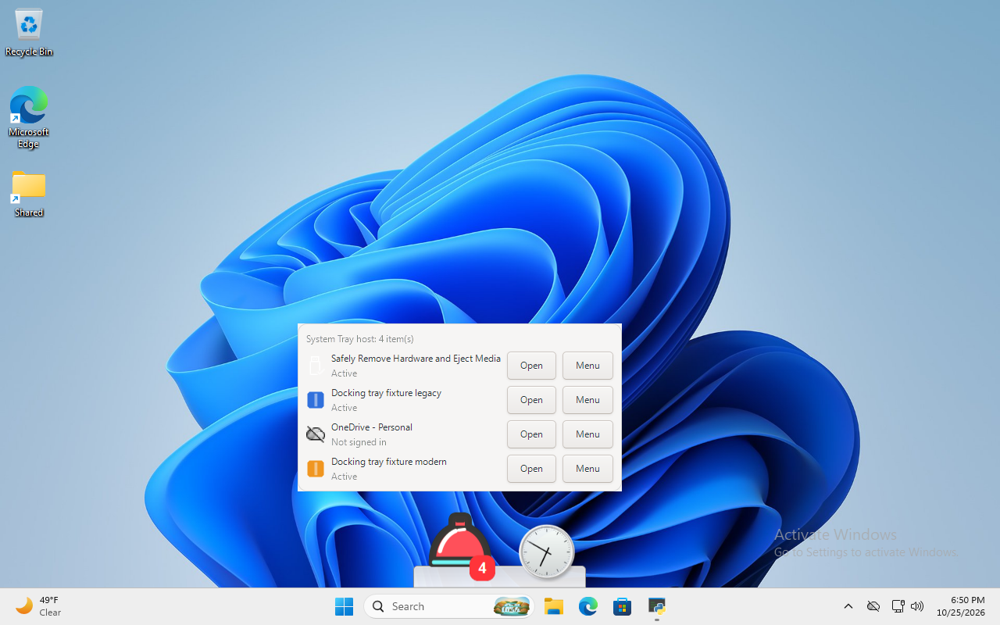

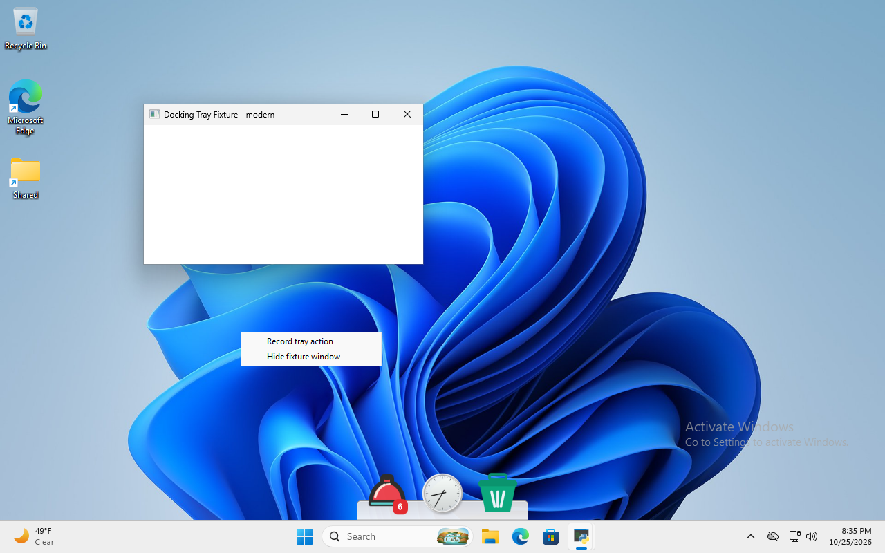

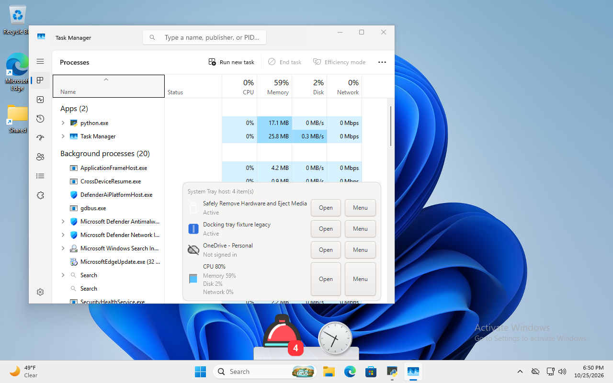

Run `tools/windows_tray_smoke.py --output PATH --task-manager` in the owned lab
with the regular dock closed and a prepared GStreamer registry. Task Manager
must not already be running. The tool uses an isolated dock configuration and
starts `tools/windows_tray_fixture.py`; each fixture has a bounded lifetime and
deletes its own icons on normal exit. Reports, independent callback journals
and screenshots remain in the output directory. The regular demo and its
pin/recent history should be restored afterward.

Add `--verify-geometry` to include independent SDK queries, popup movement and
native provider menu placement. Fixture commands use immutable revision files
so Windows SMB readers cannot block replacement of a shared command file.

Add `--restart-explorer` only in an owned test VM to include the two shell
crashes, reservation recovery, Recycle Bin round trips and live-icon handoff.
The tool refuses open Explorer folder windows and targets the verified shell
executable/PID. It recovers Explorer on failure after closing its own dock.

The shell hosting protocol is Windows implementation detail, with native
acceptance on the lab build rather than a documented replacement-host API.
Broader providers, WOW64 clients, custom hover interfaces/balloons, elevated
client policies, restart races, multiple displays/DPI and long-running sessions
remain acceptance work. Broader provider placement and real mixed-DPI/display
changes still need verification. This is an intermediate Windows milestone.

References: [notification area](https://learn.microsoft.com/en-us/windows/win32/shell/notification-area),
[notification data and callback versions](https://learn.microsoft.com/en-us/windows/win32/api/shellapi/ns-shellapi-notifyicondataw),
[foreground permission](https://learn.microsoft.com/en-us/windows/win32/api/winuser/nf-winuser-allowsetforegroundwindow),
[icon rectangle queries](https://learn.microsoft.com/en-us/windows/win32/api/shellapi/nf-shellapi-shell_notifyicongetrect),
[AppBar requests](https://learn.microsoft.com/en-us/windows/win32/api/shellapi/nf-shellapi-shappbarmessage),
[shared shell memory](https://learn.microsoft.com/en-us/windows/win32/api/shlwapi/nf-shlwapi-shallocshared),
[shell-host interoperability precedent](https://github.com/cairoshell/ManagedShell/blob/master/src/ManagedShell.WindowsTray/TrayService.cs).

## Windows Bluetooth

Bluetooth uses the shared `BluetoothBackend` contract for snapshots, radio
changes, capabilities and desktop actions. Shared state contains values and
presentation helpers. Linux/BSD desktop commands live in `unix_desktop.py` and
are selected by their implementations. Windows selects `windows.py` and its
radio implementation without loading BlueZ or Unix desktop tools.

WinRT enumerates Bluetooth adapters by their device IDs and reads their actual
radio state. Off, unknown and policy-disabled states are distinct; unknown or
disabled radios cannot be toggled. The Windows implementation runs its WinRT
requests in a hidden, bounded PowerShell process. Only an explicit user radio
change requests access. It revalidates the exact adapter ID/address, checks the
access result and reads state again before reporting success. No adapter index
is used as a persistent identity. Closing the backend rejects queued work and
stale replies cannot repaint a removed applet.

Win32 cached enumeration supplies paired/connected **classic Bluetooth** devices
for each local radio address. It does not issue inquiries. Radio, enumeration
and device-search handles are closed on success, failure and removal. Device
battery and signal strength stay unknown when the provider cannot supply them.
Windows does not expose BlueZ trust semantics. Generic connect/disconnect,
in-app pairing/removal and discovery controls are omitted by backend capability;
read-only device rows have no empty submenus. **Devices...** opens the native
**Bluetooth & devices > Devices** page, including when no radio is installed.

The owned Windows VM has no Bluetooth adapter. Native WinRT/Win32 queries and an
independent PnP oracle agree on that absence. Actual menu input, the Devices
settings page, accessibility metadata, inspected desktop captures, normal close
and work-area restoration passed. The subsequent connected/paired, on/off,
denied-change, external-change, policy-disabled and removal scenarios are
**explicit injected API fixtures**. No physical radio was changed.

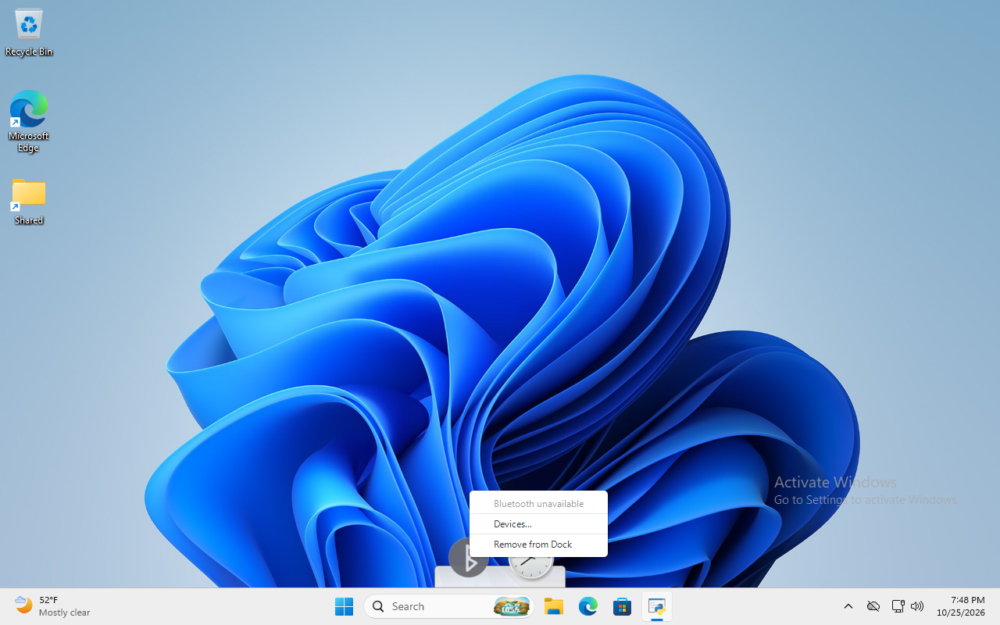

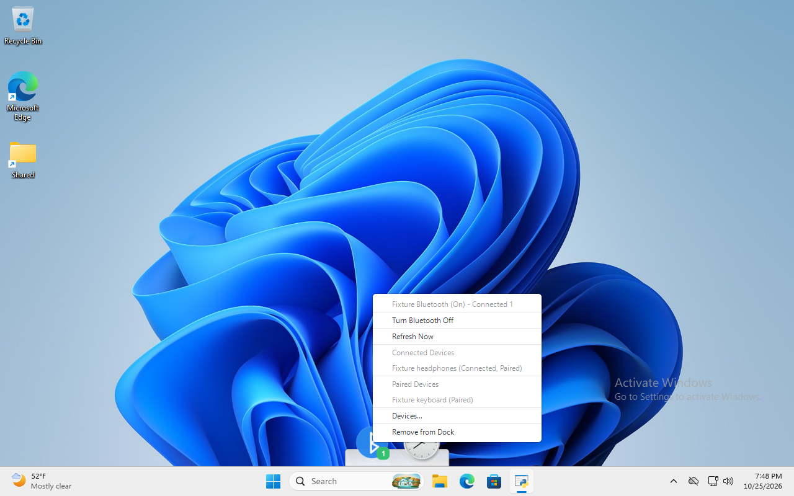

```sh
python tools/windows_lab.py --share /path/to/shared/artifacts --wait 1 start \
  'C:\msys64\ucrt64\bin\pythonw.exe' \
  '\\host.lan\Data\repo\tools\windows_bluetooth_smoke.py' \
  --output '\\host.lan\Data\lab\bluetooth-acceptance'
```

Physical radio/policy/permission behavior, multiple adapters and hotplug, BLE
inventory, active discovery, pairing, device-specific connection management,
file transfer and accessories remain part of Windows parity acceptance or
implementation. The VM fixtures do not establish hardware support.

References: [adapter enumeration](https://learn.microsoft.com/en-us/uwp/api/windows.devices.bluetooth.bluetoothadapter.getdeviceselector),
[radio state](https://learn.microsoft.com/en-us/uwp/api/windows.devices.radios.radiostate),
[radio access](https://learn.microsoft.com/en-us/uwp/api/windows.devices.radios.radio.requestaccessasync),
[radio changes](https://learn.microsoft.com/en-us/uwp/api/windows.devices.radios.radio.setstateasync),
[classic device enumeration and LE limitation](https://learn.microsoft.com/en-us/windows/win32/api/bluetoothapis/nf-bluetoothapis-bluetoothfindfirstdevice),
[device search parameters](https://learn.microsoft.com/en-us/windows/win32/api/bluetoothapis/ns-bluetoothapis-bluetooth_device_search_params).

## Windows keyboard layouts

Keyboard Layout uses the shared `LayoutBackend` contract. Input-source state,
labels, GTK presentation, polling and queued selection are shared. Linux daemon
and command integrations (GNOME, IBus, Fcitx5, MATE and XKB), Flatpak launching,
settings and layout viewers live in `keyboardlayout/linux.py`. Windows selects
`keyboardlayout/windows.py` independently and never falls back to Linux tools.
Discovery and switching run through the background worker; repeated requests
coalesce, stale polls cannot undo newer choices, and removal invalidates pending
work and replies.

Windows enumerates loaded input locales with `GetKeyboardLayoutList` and reads
the typing application's input thread with `GetKeyboardLayout`. Session-only
locale identities keep US and US Dvorak distinct even though both display EN.
Windows supplies the localized language, layout and variant descriptions. A
worker resolves the exact KLID on its own thread and restores its previous
locale before returning; the GTK interaction snapshot does not activate layouts.
No locale handles or window identities are saved in applet preferences.

Selection remains bound to the original application HWND/PID/thread identity.
The backend resolves the current focused control, including WinUI editors on a
separate thread. It retains a verified editor across the dock's temporary
foreground gap only while the same desktop is receiving input. Input-desktop
handles are always closed. A user selection restores and settles that typing
window before posting `WM_INPUTLANGCHANGEREQUEST` to its current input window.
A different foreground application, a reused/closed window, an unloaded locale
or an inactive/secure desktop prevents the old request. Readback determines the
selected source; a rejected change does not become a permanent checked choice.

The native menu service also accounts for asynchronous foreground restoration:
`SetForegroundWindow` can return success before foreground ownership changes.
Its bounded GTK retries preserve the original HWND/PID, stop when another
window takes focus, and are cancelled during shutdown. A new menu opened during
a pending restore captures a new foreground owner instead of restoring an old
application afterward.

Show Current Layout opens Windows' On-Screen Keyboard; Keyboard Settings opens
**Time & language > Typing**. Native desktop acceptance uses real menu keys,
mouse clicks and wheel input, an independent C#/Windows Forms input-locale oracle
and Notepad documents saved from physical scan-code input. The US Q key position
produces `q` with US, `a` with French and `'` with US Dvorak. The verifier loads
only its owned runtime layouts, preserves the configured preload/substitute and
default preferences, closes its saved test tabs/windows and unloads its handles.
External changes are observed through the normal two-second poll.

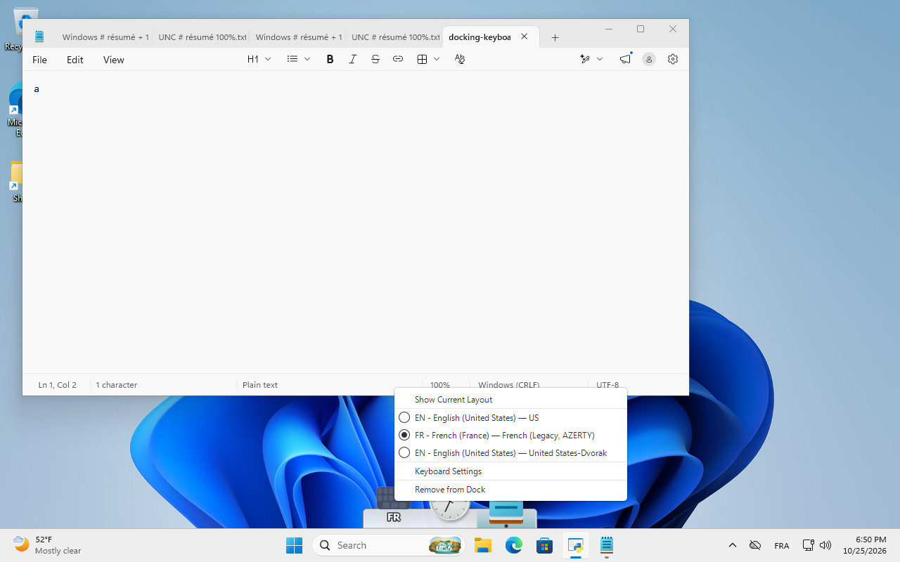

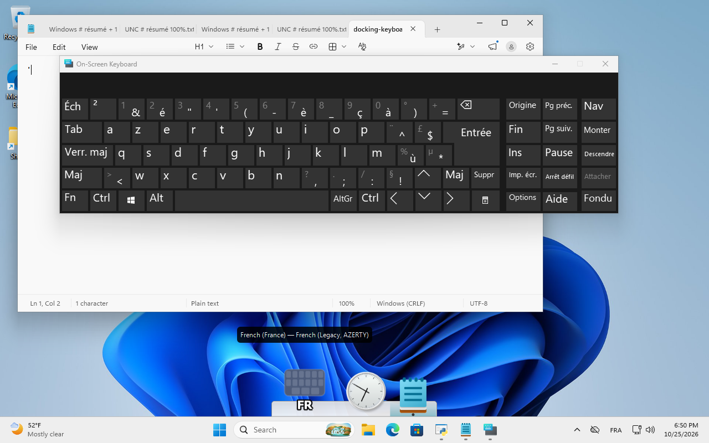

```sh
python tools/windows_lab.py --share /path/to/shared/artifacts --wait 1 start \
  'C:\msys64\ucrt64\bin\pythonw.exe' \
  '\\host.lan\Data\repo\tools\windows_keyboardlayout_smoke.py' \
  --output '\\host.lan\Data\lab\keyboardlayout-acceptance'
```

This implements Win32 input locales. Broader TSF input-processor profiles that
share an HKL, transient language identifiers, IME composition and profile-change
notifications, additional layouts, application refusals, remote sessions and
multi-user/policy cases still require further implementation or acceptance.
Those remain part of the Windows parity goal.

A native TSF investigation enabled two owned Vietnamese text-service fixtures.
The language-bar broker returned the requested thread identity and successful
activation HRESULTs, but Notepad kept US input and produced plain `aa` for both
profiles. Cleanup restored both profiles to disabled and preserved the original
input preferences. That experimental path is excluded: Microsoft marks
[`GetInputProcessorProfiles`](https://learn.microsoft.com/en-us/windows/win32/api/ctfutb/nf-ctfutb-itflangbarmgr-getinputprocessorprofiles)
as unsupported for use. The documented
[`ActivateProfile`](https://learn.microsoft.com/en-us/windows/win32/api/msctf/nf-msctf-itfinputprocessorprofilemgr-activateprofile)
flags cover the caller, process or desktop; desktop-wide activation would change
the scope of the current per-input-context selection. Per-target TSF support
remains open; API success alone was not accepted as native composition evidence.

References: [input locale enumeration](https://learn.microsoft.com/en-us/windows/win32/api/winuser/nf-winuser-getkeyboardlayoutlist),
[per-thread active input locale](https://learn.microsoft.com/en-us/windows/win32/api/winuser/nf-winuser-getkeyboardlayout),
[layout descriptions](https://learn.microsoft.com/en-us/windows/win32/intl/using-registry-string-redirection),
[layout request semantics](https://learn.microsoft.com/en-us/windows/win32/winmsg/wm-inputlangchangerequest),
[child notifications and TSF/transient ID limitations](https://learn.microsoft.com/en-us/windows/win32/winmsg/wm-inputlangchange),
[input-desktop ownership](https://learn.microsoft.com/en-us/windows/win32/api/winuser/nf-winuser-openinputdesktop).

## Windows Brightness

Brightness follows one `BrightnessBackend` interface for reading state, applying
changes to a named display and stopping work. Shared state and GTK code contain
no OS discovery, subprocesses or sysfs paths. Existing xrandr, brightnessctl and
backlight access live in `brightness/linux.py`; `brightness/windows.py` implements
the same interface for Windows.

The Windows backend identifies the primary monitor by its device interface,
uses the high-level DDC/CI brightness API when the monitor advertises support,
and otherwise matches the WMI backlight instance to that same display. WMI uses
the built-in Windows PowerShell CIM provider in a hidden process with a bounded
timeout. It never chooses the first unrelated laptop panel. Ambiguous cloned
displays and monitors without a usable provider are unavailable. Each DDC request
acquires fresh physical-monitor handles and releases them on every exit path.
Windows hardware control does not overwrite the user's gamma calibration.

The shared applet discovers devices in its background worker, observes external
changes and hotplug through polling, and renders unavailable state without a
fabricated percentage. Discrete hardware levels let wheel input advance on
panels with coarse brightness steps. Writes read back the actual device value,
including denied or rounded requests. Requests remain bound to their original
display, coalesce rapid input, reject stale polls and stop after applet removal.

The independent read-only `tools/windows_brightness_probe.py` finds one QEMU
monitor on the baseline VM. DDC capabilities/brightness return not supported
(Win32 error 50), and `WmiMonitorBrightness` has no supported instances. The live
dock correctly displays **Brightness: Unavailable**. Physical laptop panels,
DDC/CI monitors, OEM behavior, HDR and multi-display changes still require real
hardware acceptance; this VM cannot prove physical brightness changes.


`tools/windows_brightness_smoke.py` first verifies that real unavailable state,
then injects explicitly labeled DDC and WMI provider fixtures behind the Windows
backend. Real desktop wheel/click/menu input verifies scrolling, reset, denied
write readback, five-second external updates, display replacement/removal and
Show Level persistence. The fixture scenarios never write native monitor
settings. Normal dock shutdown removes its timer and restores the work area.
Native tests also execute the real WMI script under Windows PowerShell with
explicit CIM fixtures to verify instance matching, method arguments, discrete
levels and error handling. Read-only provider cycles check handle ownership.


```sh
python tools/windows_lab.py --share /path/to/shared/artifacts --wait 1 run \
  'C:\msys64\ucrt64\bin\pythonw.exe' \
  '\\host.lan\Data\repo\tools\windows_brightness_probe.py' \
  --output '\\host.lan\Data\lab\brightness-capabilities.json'
python tools/windows_lab.py --share /path/to/shared/artifacts --wait 1 start \
  'C:\msys64\ucrt64\bin\pythonw.exe' \
  '\\host.lan\Data\repo\tools\windows_brightness_smoke.py' \
  --output '\\host.lan\Data\lab\brightness-acceptance'
```

References: [monitor device identity](https://learn.microsoft.com/en-us/windows/win32/api/winuser/nf-winuser-enumdisplaydevicesw),
[monitor capabilities](https://learn.microsoft.com/en-us/windows/win32/api/highlevelmonitorconfigurationapi/nf-highlevelmonitorconfigurationapi-getmonitorcapabilities),
[DDC brightness readback](https://learn.microsoft.com/en-us/windows/win32/api/highlevelmonitorconfigurationapi/nf-highlevelmonitorconfigurationapi-getmonitorbrightness),
[WMI panel levels](https://learn.microsoft.com/en-us/windows/win32/wmicoreprov/wmimonitorbrightness),
[panel brightness method](https://learn.microsoft.com/en-us/windows/win32/wmicoreprov/wmisetbrightness-method-in-class-wmimonitorbrightnessmethods),
[gamma API limitations](https://learn.microsoft.com/en-us/windows/win32/api/wingdi/nf-wingdi-setdevicegammaramp).

## Native Windows Power Profiles

Power Profiles has one `PowerProfilesControlBackend` contract for state, profile
selection and cleanup. The shared state/presentation module contains no D-Bus or
command execution. The existing PPD, tuned and TLP detection/parsing lives in
`powerprofiles/linux.py`; Windows is selected independently in `backend.py`.
Battery and Power Profiles share the native `SYSTEM_POWER_STATUS` ABI in
`platform/backends/windows/power.py`.

The Windows implementation uses the documented Windows 11
`PowerGetUserConfiguredACPowerMode`/`DCPowerMode` and corresponding setters.
The shared Power Saver/Balanced/Performance choices map to Windows' Best power
efficiency/Balanced/Best performance user preferences. It resolves the active
supply at execution time and writes only that supply's preference. Unknown
supply status or an unsupported mode is unavailable, with no fabricated
Balanced value. Readback verifies a successful write. Bounded snapshot reads
retry source/plan changes, and the user's base power plan is preserved.

The backend reads the active plan's personality, including Balanced-derived
custom plans, through `PowerGetActiveScheme` and `PowerReadACValue`. Every
allocated active-plan GUID is copied and freed with `LocalFree`. Other plan
personalities disable mode selection and explain that a Balanced plan is
needed. The dock never replaces a user's plan to make a mode request succeed.

A version-two effective-power-mode subscription observes system overrides.
The menu continues to check the user's configured preference while a limitation
line reports an overridden effective mode, Energy Saver, Game Mode or Mixed
Reality. No callback touches GTK. Backend shutdown waits for native writes,
unregisters the callback without holding its data lock, and stops future work.
The shared applet also rejects stale poll/set replies and queued writes after
removal. Normal dock Quit removes the applet timer and releases the dock's
global shortcut.

The desktop verifier uses native mouse/keyboard input and an independent C#
P/Invoke oracle through PowerShell. It exercises all three AC modes and effective
readback, radio checkmarks, left-click cycling, external changes reaching the
polling UI, a temporary Balanced-derived plan, a non-Balanced plan and recovery.
Temporary plans and both AC/DC preferences are restored by the verifier.
An actual Energy Saver switch is located/read through UI Automation and toggled
with real mouse input. On this VM, Energy Saver Standard changes effective mode
to the efficiency state while the older `SYSTEM_POWER_STATUS.SystemStatusFlag`
battery-saver flag stays zero. That older flag is not used as proof of Energy
Saver being off. The user's selected preference remains distinct from the
effective-mode limitation.

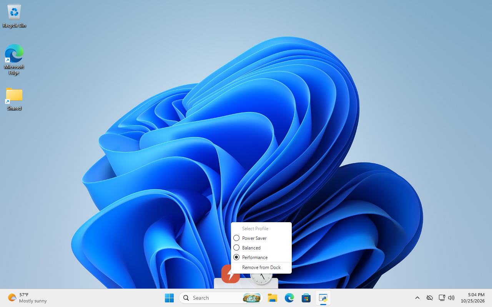

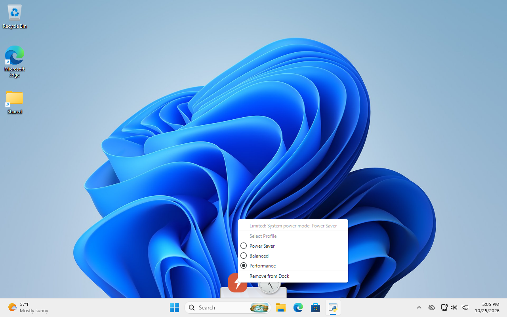

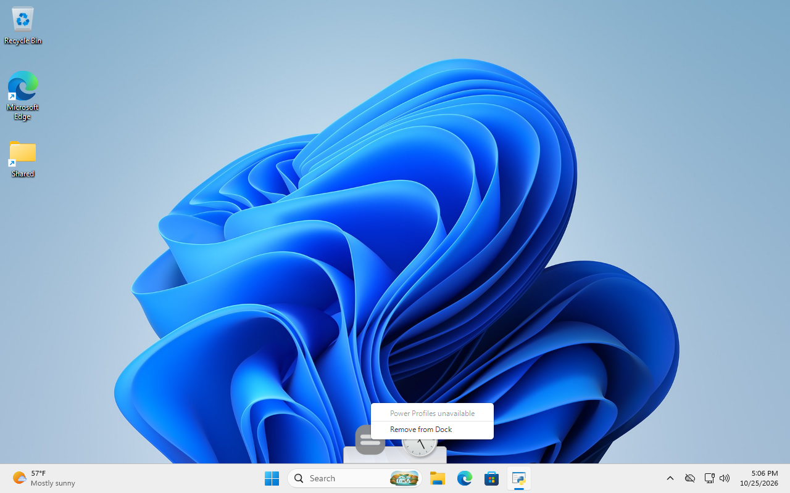

The actual Settings **System > Power** page was inspected. This VM does not
expose Settings' Power mode selector, so no selector acceptance is claimed.
Configured/effective state is verified through the independent native APIs.
Physical battery/AC transitions, OEM power management, policy restrictions and
additional Windows versions remain broader acceptance work.

```sh
python tools/windows_lab.py --share /path/to/shared/artifacts --wait 1 start \
  'C:\msys64\ucrt64\bin\pythonw.exe' \
  '\\host.lan\Data\repo\tools\windows_powerprofiles_smoke.py' \
  --output '\\host.lan\Data\lab\powerprofiles-acceptance'
```

References: [configured AC mode](https://learn.microsoft.com/en-us/windows/win32/api/powrprof/nf-powrprof-powergetuserconfiguredacpowermode),
[configured DC mode](https://learn.microsoft.com/en-us/windows/win32/api/powrprof/nf-powrprof-powergetuserconfigureddcpowermode),
[setting a mode and user/system intent](https://learn.microsoft.com/en-us/windows/win32/api/powrprof/nf-powrprof-powersetuserconfiguredacpowermode),
[effective-mode notifications](https://learn.microsoft.com/en-us/windows/win32/api/powersetting/nf-powersetting-powerregisterforeffectivepowermodenotifications),
[callback cleanup](https://learn.microsoft.com/en-us/windows/win32/api/powersetting/nf-powersetting-powerunregisterfromeffectivepowermodenotifications),
[power-plan selection](https://support.microsoft.com/en-us/windows/change-the-power-mode-for-your-windows-pc-c2aff038-22c9-f46d-5ca0-78696fdf2de8),
[power status and legacy battery saver](https://learn.microsoft.com/en-us/windows/win32/api/winbase/ns-winbase-system_power_status).

## Native Recycle Bin

Trash selects a Windows shell backend. `SHQueryRecycleBinW` reads the current
user's bin across drives, and Open Trash launches `shell:RecycleBinFolder`.
Confirmed Empty uses `SHEmptyRecycleBinW`, then checks the remaining count.
The shared confirmation keeps Cancel as its default. Query failures retain
the last observed count; failed empty requests retain the applet's error badge.
The native structure follows the SDK's different 32-bit and 64-bit alignment.

A hidden window subscribes to the virtual Recycle Bin folder with
`SHChangeNotifyRegister`. Shared notification packets are locked and unlocked
before a coalesced GTK idle refresh. The observer also schedules reconnection
on `TaskbarCreated`. Two actual Explorer restarts in one dock lifetime verify
new recycle/restore notifications after each restart, with the original count
and owned document restored. Broader restart races remain acceptance work.
Stop removes queued work, deregisters the subscription, destroys
the window and frees its folder identifier. Gio monitoring on other platforms
continues through the existing file and volume monitors.

Dropped files use `IFileOperation` with recycling and undo enabled. Windows'
warning is retained if an item cannot be recycled. Network shares and mapped
network drives are rejected because they have no client-side Recycle Bin.
Drop URI decoding preserves native drives, UNC authority and literal filename
characters before the backend chooses whether it can recycle the item.

`windows_trash_smoke.py` runs the complete dock in a lab with an initially empty
bin. It verifies external document recycling, native notifications, Open Trash
and restoration with the original contents. It drags a Unicode-named folder
from Explorer onto Trash using real mouse input, verifies the shell's recycled
folder and child contents, checks default Cancel, then confirms Empty. The
entire shell inventory must belong to the fixture before an empty request.
Normal Quit checks native observer cleanup, work-area restoration and hotkey
release. The focused suite passed 62 native Windows tests and 215 Linux tests;
three Windows-only path/ABI cases are skipped on Linux. Shared drag routing
also uses real geometry tests at all four edges.

The initial captured protocol was **`win32-dropfiles`**, GTK 3's legacy Windows
path that delivers the file on release. The OLE2 milestone below now enables
drag-motion feedback as well. The driver follows current icon geometry while
running applications can reflow the dock. Its PowerShell queries create no
console windows, and captures wait for native opening animations.

```sh
python tools/windows_lab.py --share /path/to/shared/artifacts --wait 1 start \
  'C:\msys64\ucrt64\bin\pythonw.exe' \
  '\\host.lan\Data\repo\tools\windows_trash_smoke.py' \
  --output '\\host.lan\Data\lab\trash-acceptance'
```

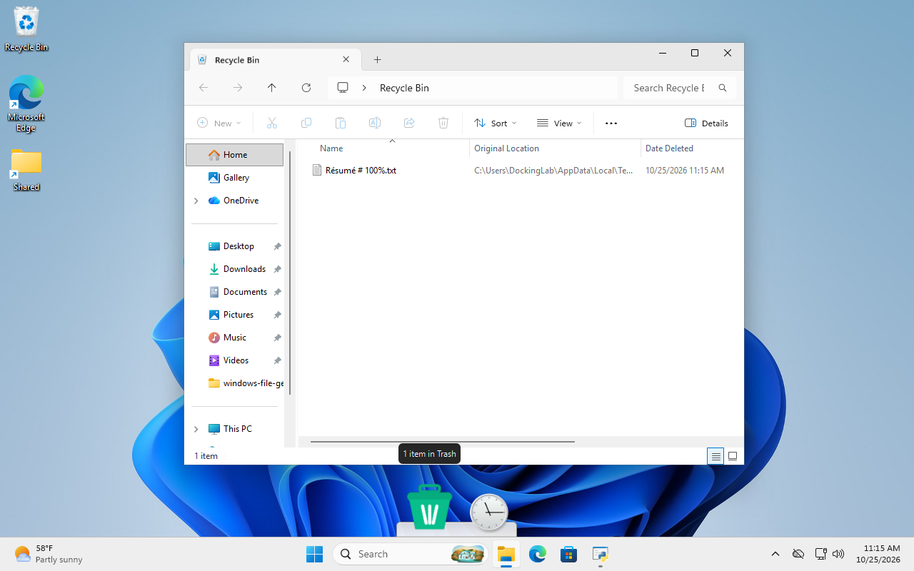

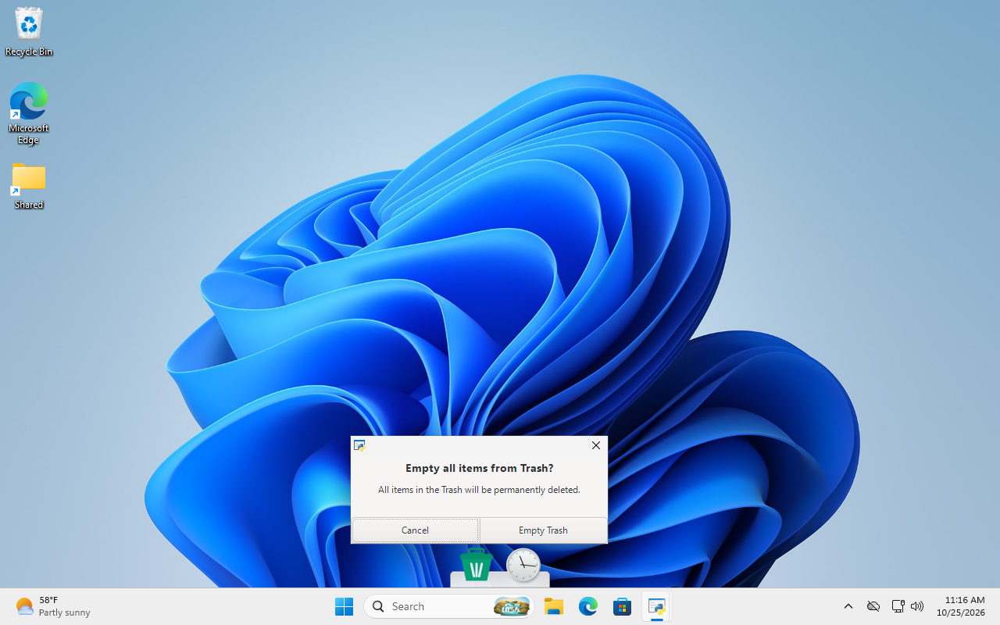

References: [Recycle Bin query](https://learn.microsoft.com/en-us/windows/win32/api/shellapi/nf-shellapi-shqueryrecyclebinw),
[empty request](https://learn.microsoft.com/en-us/windows/win32/api/shellapi/nf-shellapi-shemptyrecyclebinw),
[shell change notifications](https://learn.microsoft.com/en-us/windows/win32/api/shlobj_core/nf-shlobj_core-shchangenotifyregister),
[file operation flags](https://learn.microsoft.com/en-us/windows/win32/api/shobjidl_core/nf-shobjidl_core-ifileoperation-setoperationflags),
[GTK 3.24.52 Win32 drag implementation](https://gitlab.gnome.org/GNOME/gtk/-/blob/3.24.52/gdk/win32/gdkdnd-win32.c).

## Native drag feedback and internal gestures

Windows runtime preparation now enables GTK's OLE2 implementation before GDK
opens its display, using `GDK_WIN32_USE_EXPERIMENTAL_OLE2_DND`. This is the flag
provided by the verified GTK 3.24.52 runtime. The initial environment-only lab
probe and the subsequent normal runtime both reported **`ole2`** and delivered
drag-motion events. The desktop capture shows Trash's green target feedback
and the insertion space while an Explorer folder is held over the dock.

The same full application check also exercises internal gestures. Immediately
after the external applet drop, Calendar is dragged off and unpinned; Clock is
then moved before Trash, persisted, and dragged off as well. The check waits
for each actual GTK drag-end callback before starting another gesture, and
inspects the settled desktop images. Normal Quit restores the work area and
releases the hotkey. A separate native nested-menu/focus/close regression passed
with OLE2 enabled, as did 38 native drag/menu/hotkey tests and 81 focused Linux
drag/pointer tests.

This sequence exposed a shared state bug: an external applet drop can leave a
successful-drop flag without a source drag-end callback to clear it. Every new
internal drag now starts with a fresh flag, so a prior drop cannot suppress
drag-off removal. A regression test reproduces that complete event history.

```sh
python tools/windows_lab.py --share /path/to/shared/artifacts --wait 1 start \
  'C:\msys64\ucrt64\bin\pythonw.exe' \
  '\\host.lan\Data\repo\tools\windows_trash_smoke.py' \
  --output '\\host.lan\Data\lab\ole2-gestures' --exercise-internal
```

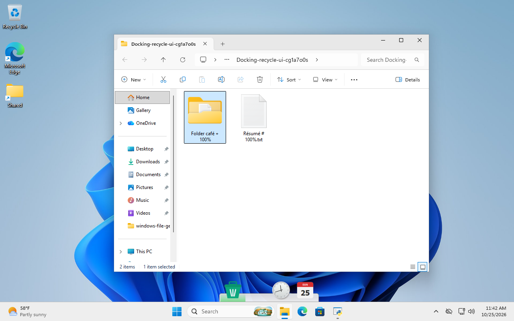

The acceptance baseline remains one display at 96 DPI. Other drop sources and
cross-monitor drags still need acceptance. See the
[GTK Win32 drag implementation](https://gitlab.gnome.org/GNOME/gtk/-/blob/3.24.52/gdk/win32/gdkdnd-win32.c).

## Applications menu pinning

Windows application listings have no desktop-entry file URI. Their menu rows
now offer the canonical application ID through a private GTK target restricted
to Docking's own process. On drop, the dock resolves the ID against its current
registry and pins the visible application at the insertion position. It does
not interpret the ID as a path or launch command. Existing desktop-file URI
transfers on Linux are preserved, and locked rows remain nondraggable.

`windows_applications_smoke.py` runs the complete application with native mouse
and keyboard input. It types Notepad into the Applications filter, drags the
actual result row onto an exposed part of the dock, and records the OLE2 target
and exact packaged application ID at the receiver. It checks persisted pinning,
verifies that the gesture did not launch the app, then clicks the new pin and
independently checks Notepad's native window and foreground ownership. After
closing its newly opened Notepad window, it reopens the menu and sends the dock
a native close request. Normal shutdown restores the original work area and
releases the Search hotkey. The final desktop PNGs were visually inspected.
Focused drag, menu and popup checks passed 137 tests on Windows, with five
POSIX-only cases skipped; all 142 passed on Linux. URI fixtures use native
file paths on each platform, while Snap, Flatpak and AppImage permission cases
remain explicitly scoped to their POSIX semantics.

The drag/reopen sequence exposed a close request lost during the applet menu's
GTK grab. Applications now prepares its menu through the dock surface's
existing Windows menu session, so native close dismisses the owned menu before
closing the dock. Applet shutdown also pops down its own menu.

```sh
python tools/windows_lab.py --share /path/to/shared/artifacts --wait 1 start \
  'C:\msys64\ucrt64\bin\pythonw.exe' \
  '\\host.lan\Data\repo\tools\windows_applications_smoke.py' \
  --output '\\host.lan\Data\lab\applications'
```


Exporting native application shortcuts to Explorer and cross-monitor gestures
remain follow-up work.

## Keyboard menus and close handling

GDK Win32 records keyboard grabs without transferring native focus. The Windows
surface temporarily makes the dock focusable and presents it before a root menu
opens. When the menu closes, it restores the original focus policy. An
out-of-context `EVENT_SYSTEM_FOREGROUND` observer retains the preceding window:
a non-activating right click can clear `GetForegroundWindow` before GTK delivers
the button event. Deferred restoration checks both HWND and process identity,
and only runs while the dock still owns foreground focus. Search, Preferences
and an outside-click target keep their newly acquired focus.

GTK suppresses a parent's delete event while another toplevel has a menu grab.
A `SetWindowSubclass` callback on the dock queues dismissal of its owned menus
before requesting the normal GTK close. It forwards other native messages.
The surface removes both native hooks and pending callbacks during shutdown;
the GDK event dispatcher remains unchanged. Search presentation also cancels
an existing GTK menu grab before showing its typing surface.

`windows_menu_smoke.py` drives the complete application with native keyboard and
mouse input. Run its two shutdown modes in separate fresh jobs. The baseline
checks navigate three menu levels, return to a parent with Left, dismiss with
Escape and restore Notepad focus, open Search by its hotkey while a submenu is
active, type into Search, invoke Search with a mouse menu action, invoke
Preferences with Enter, repeat open/dismiss cycles, and check outside-click and
hover focus. Keyboard Quit and native WM_CLOSE with an active menu must both
exit normally, restore the exact desktop work area and release the Search
hotkey. GTK observations run on the main loop, and native HWND observations
independently verify focus and destruction. The lab still uses one display,
96 DPI and the US keyboard layout.

Both `windows-menus-keyboard-verified` and `windows-menus-native-verified` passed
these stages and exited with code 0. The nested-menu, Search and close-menu
PNGs were inspected. The focused menu, runtime and Search selection also passed
102 tests under native Windows Python, with one POSIX filename case skipped.

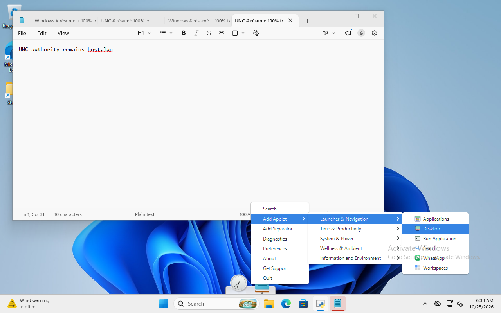

```sh
python tools/windows_lab.py --share /path/to/shared/artifacts --timeout 180 run \
  'C:\msys64\ucrt64\bin\pythonw.exe' \
  '\\host.lan\Data\repo\tools\windows_menu_smoke.py' \
  --output '\\host.lan\Data\lab\menus-keyboard' --shutdown keyboard
python tools/windows_lab.py --share /path/to/shared/artifacts --timeout 180 run \
  'C:\msys64\ucrt64\bin\pythonw.exe' \
  '\\host.lan\Data\repo\tools\windows_menu_smoke.py' \
  --output '\\host.lan\Data\lab\menus-native-close' --shutdown native
```

References: [window subclass callbacks](https://learn.microsoft.com/en-us/windows/win32/api/commctrl/nf-commctrl-setwindowsubclass),
[removing a subclass](https://learn.microsoft.com/en-us/windows/win32/api/commctrl/nf-commctrl-removewindowsubclass),
[foreground event observation](https://learn.microsoft.com/en-us/windows/win32/api/winuser/nf-winuser-setwineventhook).

## Implementation and acceptance ledger

| Area | Implementation | Required Windows evidence |
| --- | --- | --- |
| Runtime/bootstrap | Windows signals, paths, DLL bootstrap and backend selection | Native source launch and focused Windows tests passed |
| Application metadata | Gio Win32 discovery, packaged activation and background shell icons | Packaged Notepad discovery, pinning, icon and foreground launch verified; broader Win32 inventory pending |
| Basic dock | Shared GTK/Cairo UI with Windows surface adapter and scoped native menu focus | Startup, transparency, hover, mouse/keyboard/nested menus, dismissal, Preferences and both keyboard Quit and native close during a menu grab verified on the baseline desktop |
| Running applications | Native snapshots, matching and taskbar actions | Indicators, activate, minimize, restore and Close verified with Notepad; grouping/cycling have unit coverage and need multi-window desktop checks |
| Drag and drop | GTK OLE2 runtime, native URI file drops and shared internal gestures | Explorer target feedback and recycle drop, internal reorder/persistence, drag-off immediately after an external applet drop, and Applications-menu pinning/launch/close verified; broader display/source cases pending |
| Desktop integration | Native AppBar and overlap services | All four edges, taskbar coexistence, maximized-window placement and work-area restoration, six visibility modes and focus-preserving edge reveal verified on the baseline; fullscreen/restart/pressure follow-up pending |
| Displays | Pending | Multiple monitors, negative origins, DPI changes and display removal |
| Previews and overlays | Native Windows graphics capture and asynchronous UI | Occluded/live/resized source pixels and Notepad hover/focus/minimize/activation verified; menu/Search previews and typing focus verified; indicator, outlines and broader display/content cases pending |
| Search and file workflows | Native drive/UNC targets, shell associations, path Search, shared folder UI, native global hotkey, shell handoff and shared canonical/live artwork | Unicode drive/SMB metadata, previews, default-opened Notepad contents, folder stack, native Search Copy Path and Explorer file drop verified; native binding/capture/rebind/cancel, conflict, disable/enable and shutdown release verified; asynchronous native/painted artwork and same-process startup focus verified; regular shell activation with independent input, arbitrary executable/shortcut identity and broader keyboard/file/network acceptance pending |
| System applets | Native Core Audio volume, shell Recycle Bin, aggregate Battery/power, Network monitoring/Wi-Fi/VPN/settings Bluetooth radio/classic-inventory, Mic Shield capture, Cam Shield activity/policy and native notification-area backends | Volume controls, Windows keys, Sound settings and audio verified; Trash notification/recycle/restore/empty and cleanup verified; Battery native absence/oracle, overlays, Power Settings and shutdown verified, with labeled state-rendering fixtures; Network native wired metadata/counters, actual SMB traffic, selection/overlays/settings and cleanup verified; Wi-Fi profiles/radio/permissions exercised with labeled API fixtures; native IKEv2 VPN/profile menus/dialer/data/disconnect verified; Mic Shield actual two-input WASAPI capture/PID/mute/non-default input/poll/Settings verified with generated audio; Bluetooth native absence/settings and labeled radio/device fixtures verified; Cam Shield native generated-frame/two-client capture/PID/stop/idle/pulse/Settings, policy Lock/Unlock, denied new capture, continued existing capture, backend restart/recovery and restored capture verified; physical cameras and actual UAC consent remain pending; System Tray real legacy/GUID icons, startup seed, pixels, double-click/activation/native menus, updates/hide/show/delete, Task Manager and Explorer handoff verified; two actual Explorer restarts with tray/AppBar/Trash recovery and exact handoff verified; SDK icon rectangles, movement/fallback and provider menu placement verified; broader tray providers/hover/WOW64/restart races/display acceptance pending; physical Bluetooth, BLE/discovery/pairing/connections, physical wireless, global networking controls, other VPN authentication/server policies, physical batteries/accessories, other backends and broader devices pending |
| Portable applets | AI Usage native update lock and hooks; Ambient GStreamer/WASAPI playback; native Session, Power Profiles and hardware Brightness backends; shared rendering | AI Usage fixture ingestion and UI verified; Ambient all seven OGG sounds, both noise modes, native controls, volume/mute/stop and actual audio capture verified on the baseline; Session native lock, sign out, restart and power off verified with external OS state; sleep unsupported on this VM; Power Profiles native modes/effective state, Energy Saver override, custom-plan behavior and cleanup verified; Brightness unavailable state and labeled DDC/WMI fixture controls verified on the VM, physical brightness pending; full catalog, other audio devices and live provider sessions pending |
| Packaging and updates | Pending | Install, launch, update and uninstall on a clean Windows VM |
| Existing platforms | Initial regression tests pass | Keep Linux/BSD tests and desktop behavior working |

The first milestone is a visibly working basic dock. Native services and applet
backends follow that proof. Each feature must have its own Windows evidence
before its capability is advertised or its status is marked complete.
